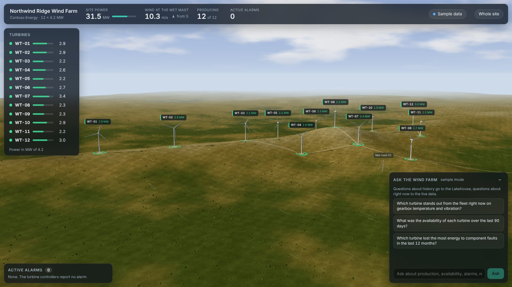
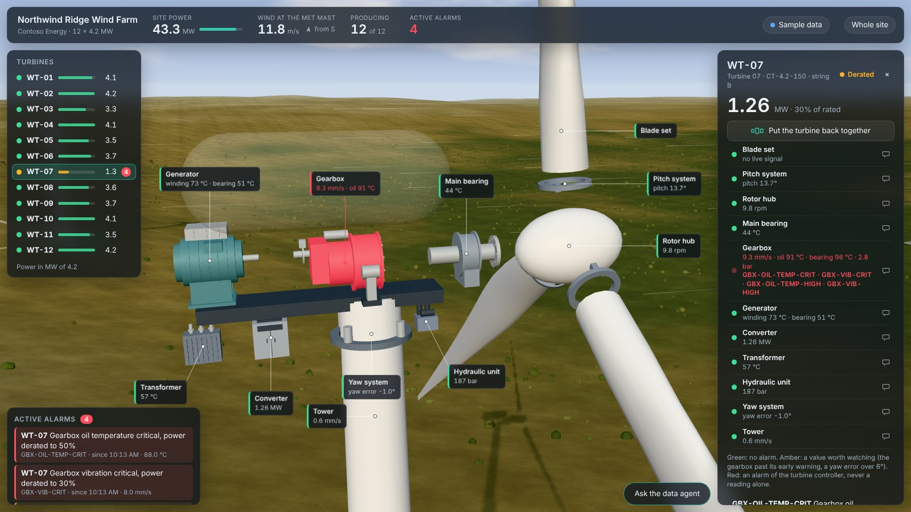

# The wind farm twin (Phase 4)

A Fabric app, built with Rayfin, that shows Northwind Ridge in 3D on live data and lets you ask the data agent questions. The deployment guide is [docs/11-deployment-guide-phase4.md](../docs/11-deployment-guide-phase4.md).

To look at it right now, without Fabric and without installing anything, open `preview/windfarm-twin-preview.html` in a browser. It runs on simulated values. Select a turbine, then **Exploded view** to take it apart, **Simulate a gearbox fault**, and **Simulate an approved limit** to see how the twin shows a command (Phase 5c).





## What is in this folder

| Path | What it is |
|---|---|
| `preview/windfarm-twin-preview.html` | The twin with its sample data in one file. No server, no network |
| `create-app.sh` | Creates the app in `windfarm-twin/`: Microsoft's template at a pinned version, its functions pack, the files of `overlay/`, three.js and the SQL driver. Run again after an update: it keeps the app and brings it up to date |
| `create-principal.sh` | Sets up, shows or removes the service principal the twin reads the Eventhouse as (real-time values). Optional |
| `overlay/packages/frontend/src/App.tsx` | Replaces the welcome screen of the template with the twin |
| `overlay/packages/frontend/src/twin/` | The twin: `scene/` (Three.js; `exploded.ts` is the inside of a turbine), `ui/` (panels and chat), `data/` (where the values come from; `components.ts` says which values and alarms belong to which component) |
| `overlay/packages/functions/src/` | The seven functions that run in Fabric as the identity of the app: `function_app.ts` registers them, `live.ts` has the queries of both routes, `principal.ts` the service principal, `sql.ts` the Lakehouse, `agent.ts` the data agent |
| `test/`, `package.json`, `build-preview.mjs`, `screenshots.mjs` | The workbench: tests of the code above, the preview build, pictures of the preview |
| `windfarm-twin/` | The app itself. It appears when you run `create-app.sh`; commit it with the rest |

The repository holds the overlay and not the whole app because the rest is Microsoft's template, which changes with every release of Rayfin. The script takes it from the scaffolder at the version the overlay was checked against (2.0.1).

## How the twin gets its values

```text
browser: React + Three.js              Fabric app: functions (TypeScript)          Fabric
  Eventhouse route, seconds old (needs create-principal.sh)
  TwinApp ── every 5 s ──────────────► getLiveState ── KQL, as a service principal ► KQL database WindFarmEH
  turbine panel ─────────────────────► getTurbineTrend ── KQL ───────────────────► KQL database WindFarmEH
  connection check ──────────────────► getDiagnostics
  Lakehouse route, minutes old (needs nothing)
  TwinApp ── every 30 s ─────────────► getLiveStateLakehouse ── T-SQL, as the owner ► Lakehouse WindFarmLH (shortcut tables)
  turbine panel ─────────────────────► getTurbineTrendLakehouse ── T-SQL ─────────► Lakehouse WindFarmLH
  connection check ──────────────────► getDiagnosticsLakehouse
  chat ──────────────────────────────► askAgent ── Model Context Protocol ───────► data agent WindFarmDataAgent
```

- A Fabric app cannot read an Eventhouse directly: Fabric gives it no token the Eventhouse accepts. Hence the two routes. The page (`data/routes.ts`) uses the Eventhouse route when it answers and the Lakehouse route otherwise, tries the Eventhouse again every two minutes, and says in its badge which one it is on.
- Each route has functions of its own, because Fabric refuses every call of a function when it cannot serve something that function declares. What one route needs can then never stop the other.
- No token and no secret reaches the browser. The functions get a token for the Fabric API and one for SQL from the platform; the service principal gets its own from Microsoft Entra ID with the secret stored in the app.
- A function never throws: it returns its result or `{ "error": … }` with the reason, which the page shows.
- The functions find the workspace, the KQL database, the Lakehouse and the data agent by name (`functions/src/config.ts`). No identifier is configured.
- `?sample` at the end of the app's address shows the simulation instead: useful when the edge VM is off.
- The twin shows commands and sends none. The command log (`CommandLog(24h)` of the KQL database, Phase 5c) is a fourth query of the Eventhouse route, read at most once in 15 seconds. On a database without it, and on the Lakehouse route, the twin works as before and shows no commands.
- `?fullquality` keeps the full picture. Without it the twin lowers its picture quality by itself when frames take longer than 55 ms, which happens on a computer without a graphics card and over a remote desktop.

## What the picture means

| You see | It means |
|---|---|
| A rotor turning | The reported rotor speed, in real time: 12 rpm is one turn in five seconds |
| A nacelle turned away from its neighbours | Its reported direction. WT-05 stands about 9 degrees off: its wind vane is not calibrated |
| Blades turned edge-on to the wind | The turbine is not producing: stopped, idle, in maintenance or in fault |
| Ring on the ground | The state, from the turbine controller: green running, amber derated, blue curtailed or maintenance, violet stopped for high wind, grey idle, paused or stopped, red and pulsing fault |
| Halo on the ground, the wide disc around the ring | The condition of the gearbox, in the same two colours as the nacelle: amber for the early warning, red when the controller has an alarm on the gearbox. It shows on any turbine in trouble, selected or not. A turbine that still runs with a gearbox alarm has a green ring in a red halo. With the gearbox in order the halo shows only around a selected turbine, in the colour of the state |
| Nacelle amber | A gearbox reading past 4.0 mm/s of vibration or 72 °C of oil temperature: the early warning the operations agent of Phase 3 watches. Also a single reading above the controller's own limits (5.5 mm/s, 78 °C) for which the controller has raised no alarm: it compares a short average with its limit and, for vibration, waits 15 seconds |
| Nacelle red | The turbine controller has a warning or critical alarm on the gearbox, and the alarm list shows it. Red never comes from a reading alone, so the picture cannot contradict the alarm list |
| White strokes in the air | The wind at the met mast: direction, and longer and faster with more wind |
| A blue card under a turbine's power | Something holds the turbine below its rated power. With the command log of Phase 5c the card says who asked for the limit, since when, until when, and whether the telemetry confirmed it. Amber: the turbine controller holds it down by itself, on an alarm. Grey: a limit is set and nothing says who asked |
| **Limited by command** in the top bar | How many turbines a command holds below rated power, from the same log. Not shown when the log cannot be read |
| The tab **Commands** beside the alarms | The commands of the last 24 hours as the edge logged them: limits, stops, resets, with who asked and what became of each. A command to all twelve turbines is one line |

Two things are not to scale, on purpose: heights of the ground are drawn 2.5 times taller, and turbines 1.8 times larger. Positions are true.

## The exploded view

Select a turbine, then **Exploded view: take the turbine apart** in its panel. The cover of the nacelle lifts off and turns to glass, the rotor stops with one blade upright, and the turbine comes apart into eleven components, each with a label and a line to its part. **Put the turbine back together**, the Esc key or another turbine closes it, and the camera goes back to where it stood. Dragging and scrolling work as before, and you can go much closer than in the view of the whole turbine. With the chat hidden the parts get more of the page.

The eleven are the component types of the reference data (`ref_components`), under the same names, so each part on the page is one the data agent and the ontology know.

| Component | Live values | What marks it |
|---|---|---|
| Blade set | None: no signal of the telemetry belongs to the blades | An alarm on `blades` |
| Pitch system | Pitch angle | An alarm on `pitch system` |
| Rotor hub | Rotor speed | Nothing in the alarm catalogue names it |
| Main bearing | Temperature | Nothing in the alarm catalogue names it |
| Gearbox | Vibration, oil temperature, bearing temperature, oil pressure | An alarm on `gearbox`. Amber before any alarm: 4.0 mm/s or 72 °C |
| Generator | Winding and bearing temperature | An alarm on `generator` |
| Converter | Active power | An alarm on `converter` |
| Transformer | Temperature | Nothing in the alarm catalogue names it |
| Hydraulic unit | Pressure | An alarm on `hydraulic system` |
| Yaw system | Yaw error | An alarm on `yaw system`. Amber when the yaw error is over 6° |
| Tower | Vibration | An alarm on `tower` |

- **Green**: no alarm on the component. **Amber**: a value past a level worth watching. **Red**: a warning or critical alarm of the turbine controller is active on it (`ActiveAlarms()`), or the gearbox is at the level of its first alarm. Alarms of severity `info`, such as a cable untwist, mark nothing.
- An alarm belongs to a component by the component name it carries, which is the `component` column of the alarm catalogue. Alarms of the controller, the grid and SCADA belong to none.
- The 6° of the yaw error is the twin's own level. The controller has no alarm on the yaw error.
- The label shows the first two values. The list in the turbine panel shows all of them and the codes of the active alarms.
- Pointing at a part marks its row in the list, and pointing at a row marks the part.
- The speech bubble at the end of a row sends a question about that component to the data agent, for example `What stops and work orders has the gearbox of WT-07 had?`.

What it is not: the machinery is a drawing of a common layout (main bearing, a three-stage gearbox and the generator in line on a bedplate, converter and transformer at the back, a hydraulic unit beside the main shaft, the yaw ring on the tower). It is not the model of a real machine, and its sizes are estimates. While a turbine is open its rotor stands still on the page; the values on the labels stay live.

## The simulation

The preview, and the app with `?sample`, run on a simulation inside the page (`data/sampleProvider.ts`). It gives each signal the level the edge simulator gives it and keeps the three standing conditions of the data: WT-05 yawed, WT-07 with a warm gearbox, WT-09 with eroded blades. **Simulate a gearbox fault** takes one turbine through the gearbox alarms of the alarm catalogue in five minutes:

| Seconds | What happens |
|---|---|
| 26 | Vibration passes 4.0 mm/s, the early warning: nacelle amber, and the gearbox amber in the exploded view |
| 42 | `GBX-VIB-HIGH` (5.5 mm/s, warning): nacelle and gearbox red |
| 62 | `GBX-OIL-TEMP-HIGH` (78 °C, warning) |
| 68 | `GBX-VIB-CRIT` (8.0 mm/s, critical): the turbine is derated to 30% of rated power and pitches its blades out |
| 104 | `GBX-OIL-TEMP-CRIT` (88 °C, critical): four active alarms |
| 150 | `GBX-OIL-TEMP-TRIP` (96 °C): the turbine stops, state `FAULT`, blades feathered |
| 215 | Restart. The alarms clear as the oil cools, the last at 235 |
| 300 | Vibration and oil temperature are back to normal |

Codes, levels, severities and what the controller does are those of `data/reference/alarm_codes.csv`, and a test compares them. The times are invented: the edge simulator takes minutes over the same sequence ([02-demo-runbook.md](../docs/02-demo-runbook.md)).

## The workbench

```bash
cd app
npm install          # with npm 10.9.9 this stopped with an error here; npm 12 worked
npm test             # 104 tests: site data, simulation, components, the opened turbine, both routes, the functions against stand-ins for Fabric
npm run typecheck
npm run preview      # rebuilds preview/windfarm-twin-preview.html
npm install --no-save playwright && npm run screenshots   # six pictures of the preview, needs Chrome
```

The tests run the function code against stand-ins: a pretend Fabric API, a pretend Eventhouse, and the reference server of the Model Context Protocol SDK in the place of the data agent. They show that the code does what it should with the answers it expects. They cannot show that Fabric gives those answers; the connection check in the app does that after deployment.
