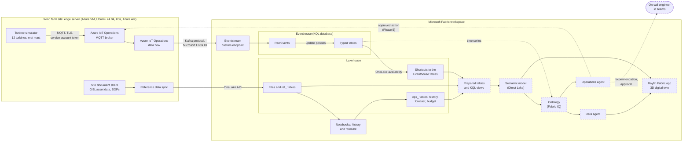

# Architecture

This document describes the whole solution, including the parts that later phases add. Phase 1, which this repository implements today, covers the edge, ingestion and storage layers. The layers above them are designed here so that Phase 1 does not have to be reworked when they arrive.

**How it is deployed.** By hand from the guides, or by `tools/deploy.py`, which starts the same scripts and notebooks in the same order, creates the Fabric items through the Fabric API, and stops with an instruction where a person has to act: [15-deployment-runner.md](15-deployment-runner.md). The architecture is the same either way; the runner's deployment has generated names for the resource group, the VM, the cluster, the instance and the workspace.

## What the demo shows

Northwind Ridge is a fictional 50.4 MW wind farm with 12 turbines. An edge server on site collects telemetry, alarms and weather from the turbines, and holds the site's documents (GIS layers, asset records, contracts, operating procedures). Everything flows to Microsoft Fabric, where it is stored next to two years of operating history, modelled and described by an ontology. A Fabric app built with Rayfin presents the farm as a live 3D digital twin with a chat panel, and an operations agent watches the data for trouble.

The demo story is a gearbox that starts to fail on turbine WT-07. The history shows it coming: for four months the gearbox has run warmer and rougher than the fleet, iron in its oil has risen, and the same bearing failed on WT-02 the year before. One command at the edge makes the problem acute. Vibration and oil temperature rise, the turbine controller raises alarms and derates the turbine, production falls behind the neighbouring turbines, and after a few minutes the fault clears by itself. In later phases the operations agent detects the fault, and then proposes a fix and applies it after an engineer approves.

The history holds more than this one story, because the people who run a wind farm ask more than one kind of question. [04-use-cases-and-data-audit.md](04-use-cases-and-data-audit.md) lists who asks what, and which data answers it.

## End-to-end view

Solid boxes exist after Phase 1. Dashed boxes come in later phases; [03-roadmap.md](03-roadmap.md) lists what each phase delivers.

The layering follows Microsoft's [wind farm maintenance reference architecture](https://learn.microsoft.com/fabric/real-time-intelligence/architectures/wind-farm-maintenance) for Fabric Real-Time Intelligence: ingest through an eventstream, keep asset metadata in OneLake, enrich in an eventhouse, then visualise and activate.

## Layers

### 1. Edge

| Component | Role | Notes |
|---|---|---|
| Azure VM, Ubuntu 24.04 | Stands in for the on-site server | 8 vCPU and 32 GB recommended; 4 vCPU and 16 GB is the supported minimum for Azure IoT Operations |
| K3s, connected to Azure Arc | Kubernetes platform managed from Azure | OIDC issuer, workload identity, cluster connect and custom locations enabled |
| Azure IoT Operations | MQTT broker and data flows | Deployed with test settings; see "Security" below |
| Turbine simulator | Plays the turbine controllers, the met mast and the SCADA alarm logic | A pod that publishes to the broker over TLS with a Kubernetes service account token. It reads the broker's CA certificate from the cluster at every connect. |
| Reference data sync | Copies the site's files to OneLake | A script on the VM, using the VM's managed identity |

Telemetry and events travel as MQTT messages through Azure IoT Operations. Files do not fit a message stream, so GIS layers, master data and SOP documents are uploaded straight to the Lakehouse through the OneLake API. A small `asset` message per turbine also carries its coordinates through the stream, so the Eventhouse can place turbines on a map without the Lakehouse.

The simulator publishes directly to the broker instead of going through an OPC UA server and the Azure IoT Operations connector for OPC UA. This keeps Phase 1 small and gives full control over the fault scenarios. An OPC UA front end can be added later without touching anything downstream, because the topics and message format would stay the same.

### 2. Ingestion

One Azure IoT Operations data flow subscribes to six topic filters and forwards the messages unchanged to the custom endpoint of one Fabric eventstream, using the Kafka protocol. The data flow endpoint authenticates with the managed identity of the Azure IoT Operations Arc extension, which is a Contributor on the Fabric workspace. No connection string or secret is stored at the edge.

The eventstream has one destination: the Eventhouse, in direct ingestion mode.

### 3. Storage

**Eventhouse.** Every message lands in `RawEvents` exactly as sent: six envelope columns and a `data` column of type `dynamic`. Update policies turn raw rows into six typed tables at ingestion time.

| Table | Content | Rows |
|---|---|---|
| `RawEvents` | Every message as received, kept 14 days | All |
| `TurbineTelemetry` | 25 SCADA signals and the operating state per turbine | 12 every 5 seconds |
| `WeatherObservations` | Met mast: wind, temperature, pressure, humidity, air density | 1 every 10 seconds |
| `AlarmEvents` | One row when an alarm is raised, one when it clears | On event |
| `TurbineStateChanges` | Operating state transitions | On event |
| `AssetRegistry` | Static attributes and coordinates of each asset | 13 every 5 minutes |
| `EdgeHeartbeats` | Liveness of the edge server | 1 per minute |

**Lakehouse.** Three groups of tables sit side by side.

| Group | Content | How it gets there |
|---|---|---|
| Six shortcuts | The typed tables of the Eventhouse, as Delta tables | Eventhouse OneLake availability; the telemetry is not copied |
| 13 `ref_` tables | Site, turbines, components with warranty, alarm catalogue, power curve, spare parts, people, on-call roster, contracts, procedures, map layers, terrain | Files uploaded from the edge to `Files/reference` and `Files/sop`; notebook 01 loads them |
| 12 `ops_` tables | Two years of operating history at 10-minute resolution, the availability log, alarms, work orders, oil and blade records, curtailments, market prices, forecast, budget | Notebooks 02 and 03 generate them in Fabric |

### 3a. One site, one past, one weather

The history is generated, and it is generated to fit the live data.

| What is shared | How |
|---|---|
| The weather | One climate model (`simulator/windfarm_sim/climate.py`) gives wind, direction, temperature and humidity for any moment in time. The history generator, the live simulator and the forecast all read it. The forecast is the same weather seen in advance, with an error that grows with the horizon. |
| The turbines | Each turbine's efficiency, temperature level and vibration level come from one function of the site's seed, used by the history and by the live simulator. |
| Conditions | `site.json` lists three standing conditions (worn gearbox on WT-07, yaw offset on WT-05, blade erosion on WT-09). The history ramps them in over the past months; the live simulator applies them from its first message. |
| The power formula | The history and the live turbine model compute power from wind, air density, efficiency and misalignment the same way. |

The history generator is part of the simulator package (`history.py`, with `catalog.py` and `climate.py`). The notebooks carry a copy of these three modules, made by `tools/build-notebooks.py`, so that they run in Fabric without installing anything. A test fails when a notebook is out of step with its source.

Each run of notebook 02 rebuilds the whole history up to the moment of the run. The weather and the random faults of the past are functions of the date, so they do not change from run to run. The planted stories are placed relative to the day of the run, so that they stay recent.

The history does not record what the live site did: a fault that you inject is in the Eventhouse, not in `ops_scada_10min`. Rolling the live data up to 10 minutes and joining it to the history is part of Phase 2.

### 4. Preparation (Phase 2)

Cleaning and enrichment happen where each engine is strongest: KQL materialized views and functions for near-real-time measures (expected power from the power curve, production gap, fleet-relative vibration), and notebooks for the dimensional tables that the semantic model needs. This phase also rolls the live telemetry up to 10 minutes, with the columns of `ops_scada_10min`, so that the model sees one continuous series from the start of the history to now.

### 5. Semantic model (Phase 2)

A Direct Lake semantic model over the Lakehouse: dimensions for site, turbine, component, alarm code, contract and date; facts for 10-minute production, events, alarms, work orders, curtailment, prices, forecast and budget; measures as defined in [04-use-cases-and-data-audit.md](04-use-cases-and-data-audit.md): availability by time, by energy and by contract, capacity factor, performance index, lost energy by cause, mean time between failures, revenue against budget.

### 6. Ontology (Phase 3)

The ontology **WindFarmOntology** has 10 entity types (site, turbine, component, work order, downtime event, alarm type, spare part, technician, procedure, contract) and 12 relationship types; [10-ontology.md](10-ontology.md) lists them. A notebook creates it from a definition. Each entity type is bound to one Lakehouse table, each relationship to a table that holds the keys of both ends, and the turbine's live signals to the Eventhouse table `TurbineTelemetry`. It is not generated from the semantic model: entity types generated that way are, as far as the documentation shows, bound to the model, and Microsoft lists as a known issue that a data agent does not work with such bindings.

### 7. Agents (Phases 3 and 5)

- A **data agent** answers questions in plain language: history from the Lakehouse in T-SQL, the live state from the KQL database in KQL. It carries the site's definitions in its instructions and example queries,. It does not use the ontology: with it attached, 33 of 52 test questions passed instead of 39 (measured on 21 November 2026). Its test set is the question bank: a notebook asks it the 39 questions that have a reference query, ten variations of them and three questions the data cannot answer, and has each answer judged against the result of the reference query ([05-question-bank.md](05-question-bank.md)). In Phase 4 the app's chat panel calls it.
- An **operations agent** looks at the live telemetry every five minutes and messages the on-call engineer in Teams when a gearbox crosses an early-warning threshold that lies below the controller's alarm. For a sudden, full fault it is not earlier than the controller, which reacts in seconds; its use is the small or slow fault the controller does not report, and the message with the evidence. In Phase 5b it also proposes to limit the turbine, with what that costs per hour and what a gearbox exchange costs, and once a person approves in Teams its action sends the command to the edge. What the edge then did is recorded by the edge itself (Phase 5c), not by the agent.

### 8. App (Phase 4)

A Fabric app built with Rayfin 2.0.1 ([11-deployment-guide-phase4.md](11-deployment-guide-phase4.md), [../app/README.md](../app/README.md)).

- **The page** is React and Three.js, hosted by Fabric behind its sign-in. It draws the terrain from the same `heightmap.json` the simulator's site uses, the roads from the GIS layer and a turbine at each registry position, and it moves what the data moves: rotor speed, nacelle direction, blade pitch, state (the ring on the ground) and gearbox condition (the halo around it and the nacelle: amber by the readings, red only by an alarm of the turbine controller). A turbine can be taken apart into the eleven components of `ref_components`; each shows its live values and takes its colour from the active alarms on that component.
- **Seven functions** run in Fabric as the identity of the app, which is its owner. `askAgent` sends a question to the published data agent through its Model Context Protocol address. The live values have two routes, each with three functions of its own (values, trend, check). No token and no secret reaches the browser.
- **A Fabric app cannot read the Eventhouse directly** (found at the first deployment, 23 November 2026): Fabric issues a token made for the Eventhouse only to an app with its own identity, and the Eventhouse refuses the token for the Fabric API. So the **Lakehouse route** reads the shortcut tables through the SQL analytics endpoint as the owner of the app, minutes behind, with nothing to set up; and the **Eventhouse route** reads the KQL database as a service principal whose secret is a secret of the app, under a minute behind, after `app/create-principal.sh`. One reading each from the deployment: 2 minutes and 56 seconds. The page uses the Eventhouse route when it answers and the Lakehouse route otherwise, and its badge says which.
- **Nothing but the principal is configured.** The functions find the workspace, the KQL database, the Lakehouse and the data agent by name.
- The same page runs on a simulation built into it: with `?sample`, and as `app/preview/windfarm-twin-preview.html`.

## Design decisions

| Decision | Reason |
|---|---|
| One eventstream and one envelope for all message types | One endpoint to secure and monitor. The envelope is identical for every message, so the raw table schema never changes when a message type is added. |
| Shape data with Eventhouse update policies, not eventstream operators | The transformation is KQL in source control, runs at ingestion, and is checked offline against the table schemas. |
| Lakehouse reads telemetry through OneLake availability and shortcuts, not through a second eventstream destination | The messages have different shapes per type, and a Lakehouse destination enforces the schema of the first record. Microsoft's Lakehouse destination article itself points to Eventhouse plus OneLake availability for this case. No telemetry is stored twice. |
| Managed identity from edge to eventstream | No secret at the edge, and it works with the test-settings deployment, which has no secret sync. |
| Files go to OneLake directly | Documents and GIS layers are files, not events. |
| Simulator commands and anomaly ground truth stay on edge-only topics (`_sim`) | The cloud must find the fault from the data, as it would in reality. Nothing in Fabric says "an anomaly was injected". |
| Separate `_control` topic for operating commands | Curtail, stop, start and reset are real control actions. In Phase 5 a cloud-to-edge data flow publishes to this topic; it cannot inject faults. |
| The edge reports the commands it was given, with the telemetry | A command is true where it is applied. The sender knows what it sent, not what arrived, and a job the agent starts has nobody reading its output. One record at the edge covers commands from Fabric and commands given locally, needs no new item in Fabric, and carries the clock of the readings it is compared with (Phase 5c). |
| Alarms are evaluated on what sensors report, with a moving average | A drifting sensor then causes a false alarm with no supporting evidence, which gives the agents a realistic case to tell apart from a mechanical fault. |
| Default fault lasts 15 minutes | An operations agent evaluates its rules every 5 minutes. A 15-minute fault keeps alarms active for about 11 minutes, so at least two evaluations see it. |
| The history is generated in a Fabric notebook, not shipped as files | 1.2 million rows are 100 MB as files and go stale the day after they are made. Generated in place, the history always ends "now", takes 10 seconds to compute, and cannot drift from the simulator, because both run the same code. |
| The weather is a function of time, not of a random seed | The history, the live data and the forecast can then only agree. It also means that two people who deploy the demo see the same weather on the same day. |
| Planted stories keep their distance to today | "The oil sample of five weeks ago" must still be five weeks old when the demo is shown next quarter. The price is that their dates move when the history is rebuilt. |
| History uses the industry's 10-minute resolution and availability categories | It is what wind farm staff work with. Their questions, and the measures in them, are defined on this resolution. |
| Every edge command is typed on the workstation (`infra/vm.sh ssh`) | In the validated run, commands were run on the wrong machine twice, and SSH access was lost to a security policy. One place to type, with the helper opening access, removes both. |

## Extension points for Fabric IQ agents

Phase 1 already carries what the agents need later.

| Need | Already in place |
|---|---|
| Evidence to diagnose a fault | Correlated signals per component (vibration, oil temperature, bearing temperature, oil pressure, power) and neighbour turbines for comparison |
| Procedures to follow | Seven SOP documents with limits, decision tables, standard setpoints and release criteria, keyed by `sopId` on every alarm |
| Who to consult | On-call roster with roles, escalation order and Teams channels; approval rules in SOP-OPS-000 and SOP-CUR-006 |
| History and logistics | Two years of work orders with findings and cost, oil analyses (including the rising iron count in WT-07's gearbox oil), the precedent on WT-02, spare parts with stock and lead time, the forecast for choosing a maintenance window, contract price and warranty dates |
| A condition to notice before any alarm | WT-07 runs warmer and rougher than the fleet, live and in the history, below every alarm limit |
| A fault that waits for a fix | `inject --hold` keeps a fault active until it is resolved |
| A way to act | Operating commands on the `_control` topic: curtail, release, stop, start, reset |

The cloud-to-edge path was built on 23 November 2026 as Phase 5a and reported as working on 24 November ([12-deployment-guide-phase5a.md](12-deployment-guide-phase5a.md)): notebook `12_send_edge_command` writes a command to the eventstream `WindFarmCommands`, and the data flow `fabric-to-windfarm-control` reads that eventstream's custom endpoint as a Kafka source, with the identity of the Azure IoT Operations extension, and publishes to the control topic. Phase 5b, built and first run on 24 November ([13-deployment-guide-phase5b.md](13-deployment-guide-phase5b.md); reported as working that evening: the message arrived, it was approved, WT-03 was curtailed), puts the operations agent in front of it: the agent watches the table `GearboxDecisionLive`, which an update policy fills with each running turbine's gearbox readings and the cost of limiting it; its message proposes the action **Curtail turbine**; and on approval in Teams that action runs the notebook as a job, with the rights of the person who created the agent.

Phase 5c, built on 25 November and run the same night ([14-deployment-guide-phase5c.md](14-deployment-guide-phase5c.md); the record, the function and the twin were seen working, the run through the agent is still to do), is the way back. The edge reports every operating command it is given, from Fabric or from the local tool, as one more kind of message on the path of Phase 1: taken or refused, for which turbine, asked by whom. The table `EdgeCommands` holds these reports, and the function `CommandLog()` puts each next to what the telemetry showed afterwards: confirmed, in force, ended. The command center notebook reads it after each send, and the twin shows who limited a turbine, since when and until when. Not built: a second message of the agent when the limit is in force, a rule that returns to a case that is still open when the limit ends, the name of the person who approved, and a work order for the event.

## Security

| Area | Phase 1 state | For production |
|---|---|---|
| Edge network | No inbound access except SSH from one address, or through just-in-time access where the subscription enforces it; all data leaves through outbound TLS | Remove the public IP; use Azure Bastion or a private path |
| Broker access | TLS and service account token authentication, the Azure IoT Operations defaults; no authorization policy | Add broker authorization so each client can use only its own topics |
| Edge to Fabric | Managed identity, Contributor on the workspace | Same, with a dedicated workspace for ingestion |
| Azure IoT Operations settings | Test settings: no Key Vault secret sync, system-assigned identity | Enable secure settings |
| VM identity | Arc onboarding role on the resource group, Reader on the subscription, Contributor on the Fabric workspace | Remove Reader after onboarding; scope OneLake access to the Lakehouse |

## What has and has not been verified

Three levels of evidence, kept apart on purpose.

**Run live.** Steps 1 to 8 of the deployment guide were run once, on 19 November 2026, with the first delivery of this repository: Azure Cloud Shell as the workstation, a Microsoft-managed demo subscription, `southcentralus`, VM size `Standard_D8s_v7`, Ubuntu 24.04, K3s from the stable channel, Arc onboarding with the VM's managed identity, CLI extension `azure-iot-ops` 2.11.2.

| Part | Evidence from that run |
|---|---|
| VM, K3s, Azure Arc, Azure IoT Operations with test settings | Deployed; the scripts of steps 1 to 4 ran to the end (step 1 after a change of VM size) |
| Simulator to MQTT broker with TLS and service account token | Telemetry from all 12 turbines and the met mast reached Fabric |
| Data flow to the eventstream with managed identity | Events arrived about 10 seconds after their timestamp |
| `01-tables.kql`, `02-update-policies.kql`, the ingestion mapping | Typed tables filled; confirmed by screenshot of the Get data wizard with the existing mapping |
| OneLake availability and shortcuts, reference data sync, notebook 01 (first version) | Reported done by the user; the results of the checks in steps 6.8, 7.4 and 7.5 were not reported back |
| Fault injection | Run and reported done; what was seen in Fabric was not reported back |

**Second live run, 20 November 2026, with this version.** Steps 1 to 8 on a new deployment, after the first one had been removed with `infra/99-cleanup.sh`. Seen in output the user sent: the failed uninstall during the clean-up, `az iot ops init` and `create`, the simulator 1.1.0 start through `vm.sh run`. Reported by the user without output: the clean-up deleted the Fabric items from Cloud Shell; steps 6 to 8 done; the four notebooks ran in Fabric and their checks matched the guide. Four obstacles, 15 to 18 in the validation log.

**Tested without Azure and Fabric.** What the table says for each part. Changes made after the second run are marked in the README.

| Part | How it was tested |
|---|---|
| Simulator 1.1.0: climate wind, turbine character, standing conditions, alarm clearing on shutdown, CA refresh, restart when offline | 57 automated tests, passing on Python 3.13 and on Python 3.11. Installed as the container image installs it (Python 3.12, numpy only) and started without a broker. The CA refresh was tested against a stand-in for the Kubernetes API, not on a cluster. The image itself was not built. |
| History generator | 11 tests of its own. Run on Python 3.13 with pandas 3.0 and on Python 3.11 with pandas 2.1 and numpy 1.26: the output is identical. |
| Notebooks 01 to 04 | All 55 code cells run with `tools/local-spark/run_notebooks.py` in two local Spark sessions, chosen to match the two Fabric runtimes: Spark 3.5.1 on Python 3.11 (Runtime 1.3 has Spark 3.5 and Python 3.11), and Spark 4.1.4 on Python 3.13 and Java 21 with ANSI SQL mode on, the default of Spark 4 (Runtime 2.0 has Spark 4.1, Python 3.13 and Java 21). Two substitutions in both: tables were written as Parquet instead of Delta, and the one `DELETE` statement of notebook 03 was emulated. The Delta Lake library was not available in the test environment. |
| Question bank, 39 SQL queries | All run in both Spark sessions against the generated tables, with the same answers; results read and checked against the planted stories |
| Question bank, 4 KQL queries; changed `ActiveAlarms()` | Parsed with the Kusto language service. Not run in an Eventhouse. |
| `infra/vm.sh`, `infra/01-create-edge-vm.sh`, where-it-runs checks | 27 scenario tests against stand-ins for `az`, `ssh`, `scp` and `curl` (`tools/script-tests/run.sh`); ShellCheck; argument formats of the `az` commands checked with Azure CLI 2.93.0 where they were added in the first run |
| `infra/99-cleanup.sh` | 31 scenario tests against stand-ins for `az`, which also stand in for the Fabric REST API: what is deleted and what is left, the order, a stopped VM, a cluster that Azure cannot reach yet or at all, a failed uninstall or deletion, no Fabric token, a resource group that is not the demo's. Commands and options checked against Azure CLI 2.93.0 and the source of extension `azure-iot-ops` 2.11.2; the Fabric endpoints read from Microsoft Learn. Run once against Azure, on 20 November 2026, in its first version: the uninstall step failed because Azure could not reach the cluster, which led to the retries of the current version; the outcome of that run is not reported yet. |
| Just-in-time access request | Built from Microsoft's SDK definition of the `initiate` action. Not run against Azure. |

**Phase 2.** [07-deployment-guide-phase2.md](07-deployment-guide-phase2.md) has its own table of what was and was not tested, and [phase2-validation-log.md](phase2-validation-log.md) the record of its first run.

**Phase 3.** Deployed on 21 November 2026. [09-deployment-guide-phase3.md](09-deployment-guide-phase3.md) lists what ran with output seen, what was only reported, and what was checked without Fabric; [phase3-validation-log.md](phase3-validation-log.md) is the record.

**Phase 4.** Deployed on 23 November 2026. [11-deployment-guide-phase4.md](11-deployment-guide-phase4.md) separates what I saw from the tenant (seven connection checks, two screenshots, both routes for the live values working), what was reported and not seen (the successful deployments, the sign-in on WSL), what was not reported at all (the chat), and what ran without Fabric (104 tests of the app's code, the app inside Microsoft's template, the pictures of the preview). [phase4-validation-log.md](phase4-validation-log.md) is the record.

**Phase 5.** 5a and 5b ran on the tenant on 24 November 2026 and were reported as working; I saw the outputs of four steps of 5b and none of 5a's working run. 5c was built and run on 25 November: its steps 1 to 5 were seen working in the twin, its step 6 has not run. [phase5-validation-log.md](phase5-validation-log.md) is the record, with what was seen, what was reported and what is unproven for each of the three.

**Not tested.** The upgrade of a running deployment as one sequence; `infra/rebuild-env.sh` against Azure; a successful `az iot ops delete` through the clean-up script; stopping and restarting the VM and the capacity; the checks added after the second run, against Azure; the just-in-time request of `vm.sh`. Not confirmed: the KQL added since the first run, in an Eventhouse.

[phase1-validation-log.md](phase1-validation-log.md) has the obstacles of the live run and what was changed for each. Expect to meet a few more when you run the new parts for the first time; [troubleshooting.md](troubleshooting.md) covers the likely places.
