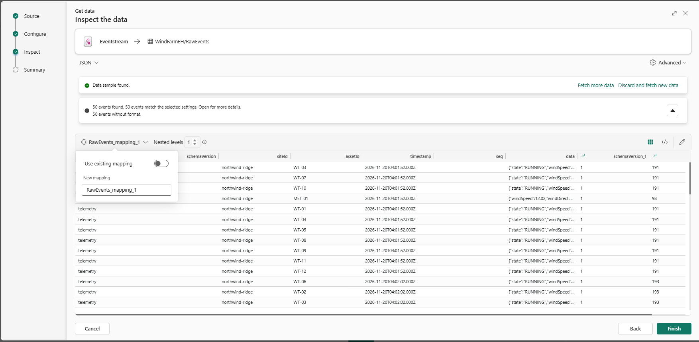
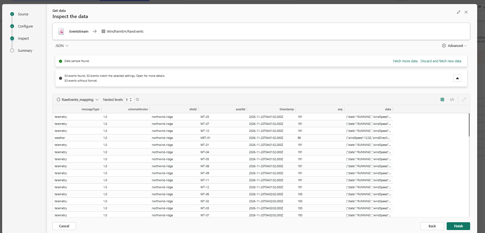

# Phase 1 deployment guide: from the edge to the Eventhouse and Lakehouse

This guide builds Phase 1 from nothing: an Azure VM that plays the wind farm's edge server, Azure IoT Operations on it, the turbine simulator, and the Fabric items that receive and store the data. At the end:

- telemetry from 12 simulated turbines flows live into a Fabric Eventhouse and Lakehouse,
- the Lakehouse holds two years of operating history, the forecast, the contracts and the reference data that the questions of a wind farm's staff need,
- one command at the edge injects a gearbox fault that you can follow in KQL.

Allow 3 hours for the first run. About 45 minutes of that is waiting for Azure deployments.

> **Status.** Steps 1 to 8 were deployed live twice in November 2026, in a Microsoft-managed demo subscription, region `southcentralus`: the first version of this repository on the 19th, and this version on the 20th after the first deployment had been removed with `infra/99-cleanup.sh`. The two runs met 20 obstacles; the guide and the scripts are written around them, and [phase1-validation-log.md](phase1-validation-log.md) lists each one. The changes made after the second run (the check of the object ID, the longer health wait in step 4, `vm.sh ssh` falling back to `run`, `rebuild-env.sh`) have scenario tests against stand-in commands and have not run against Azure. [00-architecture.md](00-architecture.md) has the exact list under "What has and has not been verified". Phase 2 continues in [07-deployment-guide-phase2.md](07-deployment-guide-phase2.md).

## Contents

- [What you will build](#what-you-will-build)
- [How to read the steps](#how-to-read-the-steps)
- [Step 0: Prerequisites and configuration](#step-0-prerequisites-and-configuration)
- [Step 1: Create the edge VM](#step-1-create-the-edge-vm)
- [Step 2: Prepare the edge host](#step-2-prepare-the-edge-host)
- [Step 3: Connect the cluster to Azure Arc](#step-3-connect-the-cluster-to-azure-arc)
- [Step 4: Deploy Azure IoT Operations](#step-4-deploy-azure-iot-operations)
- [Step 5: Deploy the turbine simulator](#step-5-deploy-the-turbine-simulator)
- [Step 6: Create the Fabric items and connect the edge](#step-6-create-the-fabric-items-and-connect-the-edge)
- [Step 7: Lakehouse, reference data and history](#step-7-lakehouse-reference-data-and-history)
- [Step 8: Run the anomaly demo](#step-8-run-the-anomaly-demo)
- [Step 9: Stop, start, cost and clean-up](#step-9-stop-start-cost-and-clean-up)
- [Commands at a glance](#commands-at-a-glance)
- [Sources](#sources)

## What you will build

| Where | What |
|---|---|
| Azure | Resource group, Ubuntu 24.04 VM, Arc-enabled Kubernetes cluster, Azure IoT Operations instance with its storage account, schema registry and Device Registry namespace |
| Edge VM | K3s, the Azure IoT Operations MQTT broker and data flow, the simulator pod |
| Fabric | A workspace with an eventstream, an Eventhouse (7 tables, 6 update policies), a Lakehouse (6 shortcuts to Eventhouse tables, 13 reference tables, 12 history tables, the SOP documents) and 4 notebooks |

## How to read the steps

Every command in this guide is typed in one place: a bash shell on your workstation, in the root folder of the repository. Each step carries one of three marks.

| Mark | Meaning |
|---|---|
| **[Workstation]** | The command runs on your workstation and works on Azure. |
| **[Workstation, on the VM]** | You type the command on your workstation; `bash infra/vm.sh ssh` carries it to the edge VM and runs it there. You see the output as if it ran locally. |
| **[Fabric]** | You work in the Fabric portal. |

The scripts check where they run. A script of `infra/` stops when it is started on the VM, and a script of `edge/scripts/` stops when it is started anywhere else, each with a message that says what to do.

`bash infra/vm.sh` is the helper for everything about the VM. Three of its actions reach the VM:

| Action | What it does | Use it for |
|---|---|---|
| `bash infra/vm.sh ssh COMMAND` | Runs one command on the VM, in the repository folder, over SSH. Opens SSH access first if it is closed. | Every edge step of this guide |
| `bash infra/vm.sh ssh` | Opens a shell on the VM | Looking around; commands with quotes or special characters |
| `bash infra/vm.sh run COMMAND` | Runs one command through the Azure VM agent, without SSH. Not interactive, at least 20 seconds, and only the last 4,096 bytes of output come back. | Subscriptions where you cannot get SSH at all |

## Step 0: Prerequisites and configuration

### Azure

- A subscription where you are Owner, or Contributor plus User Access Administrator. The deployment creates role assignments.
- Quota for 8 vCPUs of a D-series family in the region you choose.
- A region that Azure IoT Operations supports: `eastus`, `eastus2`, `westus`, `westus2`, `westus3`, `southcentralus`, `westeurope`, `northeurope` or `germanywestcentral`.

**If your subscription is managed by your organisation**, as Microsoft-internal demo subscriptions are, expect two things. Both happened in the validated run.

1. *SSH is governed by just-in-time access.* Microsoft Defender for Cloud replaces the SSH rule that step 1 creates, usually within a few hours. From then on port 22 is closed until you ask for access, and each grant lasts a few hours. You do not have to do anything about this: `bash infra/vm.sh ssh` and `bash infra/vm.sh push` notice it and ask for access themselves. Do not create SSH rules by hand; they are removed again.
2. *Not every VM size is offered.* The validated subscription was offered no v4 or v5 sizes in `southcentralus`. Step 1 tries the sizes in `VM_SIZE` in order and uses the first one that works.

### Fabric

- A workspace on a Fabric capacity, where you are Admin or Member. A trial capacity is enough for Phase 1. The operations agent planned for Phase 3 is not supported on trial capacities, so use a paid capacity if you want one workspace for all phases.
- A Fabric administrator must enable two tenant settings (Admin portal, **Tenant settings**, **Developer settings**), because managed identities authenticate to the eventstream and to OneLake:
  - **Service principals can use Fabric APIs**
  - **Allow Service principals to create and use profiles**

### Workstation

Use either of these.

| Workstation | Setup | Know before you start |
|---|---|---|
| **Azure Cloud Shell** (bash) | None. The Azure CLI, `ssh`, `tar` and `python3` are there and you are signed in. | A session ends after 20 minutes without keyboard activity, also while a long command runs: press Enter now and then during step 4. Files survive between sessions only if Cloud Shell was set up with a storage account. If `ls ~/clouddrive` fails, your session is temporary: the repository, `config/demo.env` and the SSH key are gone when it ends. Set up storage first (Cloud Shell **Settings**, **Reset user settings**, then choose **Mount storage account**). Cloud Shell often may not read Microsoft Entra ID, which matters once, in step 1. |
| **Your own machine** | Linux, macOS, or Windows with WSL. Azure CLI 2.70 or later (`az version`), `ssh`, `tar`, `curl`. Sign in as a user: `az login`. | Use a user account, not a service principal. |

Both validated runs started in Cloud Shell, with Azure CLI extension `azure-iot-ops` 2.11.2. The second moved to Ubuntu on WSL when Cloud Shell had lost the folder; [troubleshooting.md](troubleshooting.md) has the three commands that bring a new workstation up to date ("The workstation lost its copy…").

Three habits that avoid obstacles of those runs:

- **Do not use `sudo`** for the scripts of this repository on the workstation. Under `sudo` the Azure CLI is a different user without your sign-in, and the SSH key lands in root's home.
- **Keep one copy of `config/demo.env`.** After a change, `bash infra/vm.sh push-env` gives the VM the same file.
- **In Cloud Shell, check `ls ~/clouddrive` first.** Without a storage account, everything in the home folder is gone when the session ends.

### Get the repository

**[Workstation]**

1. Put the archive `fabric-windfarm-digital-twin-auto.zip` on the workstation and unpack it. In Cloud Shell: select **Manage files**, **Upload** in the toolbar, choose the zip, then:

   ```bash
   cd ~ &&
   python3 -m zipfile -e fabric-windfarm-digital-twin-auto.zip . &&
   cd fabric-windfarm-digital-twin-auto
   ```

   `python3 -m zipfile` is used because `unzip` is missing on a fresh Ubuntu, WSL included. If you keep the repository on GitHub, `git clone` it instead.

   Every command in this guide starts a script through `bash` (`bash infra/vm.sh status`, not `./infra/vm.sh status`). Keep that form when you type commands of your own: an unpacked or merged copy has no execute permission on the script files, and the direct form then answers "Permission denied".

2. Keep an unpacked copy on the computer where your browser runs as well. In steps 6 and 7 you paste KQL files and import notebooks into the Fabric portal from there.

### Configure

**[Workstation]**

1. Create your configuration file and open it in an editor.

   ```bash
   cp config/demo.env.example config/demo.env && nano config/demo.env
   ```

2. Fill in these values. The rest have working defaults.

   | Setting | Value |
   |---|---|
   | `SUBSCRIPTION_ID` | Your subscription ID (`az account show --query id --output tsv`) |
   | `LOCATION` | A supported region. The default is `southcentralus`. |
   | `STORAGE_ACCOUNT_NAME` | A globally unique name, 3 to 24 lowercase letters and digits |
   | `SCHEMA_REGISTRY_NAMESPACE` | Unique within your tenant. Change the default if someone in your tenant has used it. |
   | `FABRIC_WORKSPACE_NAME`, `FABRIC_LAKEHOUSE_NAME` | The names you will use in steps 6 and 7. Avoid spaces. |
   | `VM_AUTO_SHUTDOWN_UTC` | When the VM shuts down every day, as `HHMM` **in UTC**. See below. |
   | `AZ_LOGIN_MODE` | `identity` or `device`. See below. |

   `CUSTOM_LOCATIONS_OID`, `EVENTSTREAM_BOOTSTRAP_SERVER` and `EVENTSTREAM_TOPIC` are filled in later.

3. Leave these as they are unless you have a reason.

   | Setting | What it is |
   |---|---|
   | `VM_SIZE` | A list of VM sizes to try, in order. All have 8 vCPUs and 32 GB. |
   | `VM_ADMIN` | The administrator account on the VM, `azureuser`. This is the name SSH signs in with, not your own name. `bash infra/vm.sh ssh` uses it for you. |
   | `AIO_SKU` | The pricing tier of Azure IoT Operations, Standard or Essentials. Blank means the default of the CLI, which is what the validated run used. |
   | `SIM_IMAGE` | The simulator image, `windfarm-simulator:1.2.0` |

**Choosing the daily shutdown time.** The VM stops itself once a day to limit cost. The time is UTC, so choose an hour when you are asleep: the default `0800` is 02:00 in Houston and Chicago, 03:00 in New York, 09:00 in Berlin. A time in your evening stops the VM in the middle of your work, and a stopped VM looks like a broken one: SSH times out and the cluster shows as Offline. Leave the setting blank for no shutdown.

**Choosing `AZ_LOGIN_MODE`.** Step 3 runs the Azure CLI on the VM to connect the cluster to Azure Arc, and the CLI must sign in there.

| Mode | How the VM signs in | Choose it when |
|---|---|---|
| `identity` (default) | With the VM's managed identity. Step 1 gives that identity the role "Kubernetes Cluster - Azure Arc Onboarding" on the resource group and Reader on the subscription. | Your tenant blocks the device-code flow, which is common where sign-in requires a managed device. The validated run used this mode. |
| `device` | As you, with `az login --use-device-code`. No roles are given to the VM identity. | Your tenant allows the device-code flow. This is the sign-in the Microsoft documentation describes. |

**One settings file, two places.** The VM gets a copy of `config/demo.env` in step 1. Whenever you edit the file afterwards, send it to the VM again:

```bash
bash infra/vm.sh push-env
```

## Step 1: Create the edge VM

**[Workstation]**

```bash
bash infra/01-create-edge-vm.sh
```

The script:

1. Registers the resource providers that Azure Arc and Azure IoT Operations use.
2. Creates the resource group and an Ubuntu 24.04 VM with a 128 GB disk and a system-assigned managed identity. It tries the sizes of `VM_SIZE` in order, skips the ones your subscription is not offered, and says which one it used. It creates an SSH key if you have none.
3. Opens SSH (port 22) only to the public address of the machine you run it from. In Cloud Shell that is the address of Cloud Shell.
4. Schedules the daily shutdown and prints the time in several time zones.
5. In `identity` mode, assigns the two roles described above to the VM's managed identity.
6. Prints the VM's public address and the Custom Locations object ID.

Two messages of `az vm create` are harmless: a recommendation about Trusted Launch, and "No access was given yet … `--scope` was not provided". The script assigns the roles itself in the next step.

The script is safe to run again. It keeps a VM that exists.

When it finishes:

1. Copy the printed object ID into `config/demo.env`:

   ```bash
   CUSTOM_LOCATIONS_OID="the value printed by the script"
   ```

   **If the script warns that it could not read the object ID**, your session may not read Microsoft Entra ID. That is common in Cloud Shell. Get the ID in one of these ways, then put it in `config/demo.env`:

   - In Cloud Shell, sign in again interactively and repeat the lookup:

     ```bash
     az login --use-device-code &&
     az ad sp show --id bc313c14-388c-4e7d-a58e-70017303ee3b --query id --output tsv
     ```

   - Run the same `az ad sp show` command on your own machine, signed in to the same tenant.
   - In the Azure portal: **Microsoft Entra ID**, **Enterprise applications**, remove the filter **Application type**, search for `Custom Locations RP`, and copy its **Object ID**.
   - Ask a tenant administrator for the object ID of the application with ID `bc313c14-388c-4e7d-a58e-70017303ee3b`.

2. Copy the repository, with your `config/demo.env`, to the VM:

   ```bash
   bash infra/vm.sh push
   ```

   Run `push` again whenever files of the repository change. It replaces the repository's folders on the VM and gives the scripts their execute permission.

**Check.**

```bash
bash infra/vm.sh status
bash infra/vm.sh ssh hostname
```

`status` shows the power state, the address, the daily shutdown and whether SSH is open to you. The second command prints `vm-windfarm-edge`.

If SSH does not work in your subscription even through `bash infra/vm.sh ssh`, see "SSH does not connect" in [troubleshooting.md](troubleshooting.md). Every edge step also works as `bash infra/vm.sh run bash ./edge/scripts/…`, without SSH.

## Step 2: Prepare the edge host

**[Workstation, on the VM]**

```bash
bash infra/vm.sh ssh bash ./edge/scripts/02-prepare-host.sh
```

The script installs the Azure CLI with the `connectedk8s` and `azure-iot-ops` extensions, K3s (without Traefik), Helm and Docker, sets the kernel limits that Azure IoT Operations requires (`fs.inotify.max_user_instances`, `fs.inotify.max_user_watches`, `fs.file-max`) and points `kubectl` at the cluster. It takes about 5 minutes.

**Check.** One node with status `Ready`:

```bash
bash infra/vm.sh ssh kubectl get nodes
```

## Step 3: Connect the cluster to Azure Arc

**[Workstation, on the VM]**

```bash
bash infra/vm.sh ssh bash ./edge/scripts/03-arc-enable.sh
```

The script signs in on the VM (managed identity or device code, according to `AZ_LOGIN_MODE`), then:

1. Connects the cluster to Azure Arc with the OIDC issuer and workload identity enabled and automatic agent upgrade disabled, as Azure IoT Operations requires.
2. Writes the cluster's OIDC issuer URL into `/etc/rancher/k3s/config.yaml` as the service account issuer.
3. Enables the cluster connect and custom locations features, using `CUSTOM_LOCATIONS_OID`.
4. Restarts K3s.

It takes 5 to 10 minutes. The script stops in three cases, each with a message that says what to do:

- `CUSTOM_LOCATIONS_OID` is empty: the VM has an old copy of your settings. Run `bash infra/vm.sh push-env` and start the step again.
- `CUSTOM_LOCATIONS_OID` is not an object ID, for example a name. Azure would accept any value here without checking it, and the mistake would show only in step 4.
- The Azure CLI reports that it left the custom locations feature out. In `identity` mode that happens when the Reader role of step 1 is not in force yet: wait five minutes and run the step again.

The warning that the CLI cannot validate the object ID and proceeds with the one provided is expected when the VM signs in with its managed identity.

**Check.** The table at the end shows `connectivity` as `Connected`, and the pods in the `azure-arc` namespace are `Running`:

```bash
bash infra/vm.sh ssh kubectl get pods -n azure-arc
```

In `identity` mode you can now remove the Reader role that step 1 gave the VM identity on the subscription. Keep the VM identity itself; step 7 uses it.

## Step 4: Deploy Azure IoT Operations

**[Workstation]** This step runs on the workstation, as you. The VM's identity may not create the Azure resources it needs.

```bash
bash infra/04-deploy-iot-operations.sh
```

The script:

1. Checks that `CUSTOM_LOCATIONS_OID` has the form of an object ID and that the cluster is connected.
2. Creates a storage account with hierarchical namespace, a schema registry on it and an Azure Device Registry namespace. Azure IoT Operations requires all three.
3. Runs `az iot ops init`, which installs the foundation services on the cluster.
4. Runs `az iot ops create`, which deploys the instance with test settings.
5. Prints the name of the Azure IoT Operations Arc extension, for example `azure-iot-operations-ab1cd`. **Note this name.** Its managed identity has the same name, and you give it access to the Fabric workspace in step 6.5.

`init` and `create` each take several minutes; allow 20 to 40 minutes in total. Both show progress in the terminal. In the second validated run `init` took 6:32 and `create` 15:30.

Before they deploy, both commands ask Azure Resource Health about the cluster. Azure reports a cluster as unavailable ("Degraded") for some minutes after it was connected in step 3, and again after `init` has installed its extensions, although every agent runs. The script therefore lets both commands wait for up to 20 minutes; a line "retrying" every 30 seconds is that wait. Run the script again at any time: it skips what exists, and it skips `init` and `create` when the instance exists.

If `create` stops with `Custom Locations Error: "Microsoft.ExtendedLocation" resource provider does not have the required permissions`, the object ID of step 3 was wrong; see "Step 3: custom locations are not enabled" in [troubleshooting.md](troubleshooting.md).

> **In Azure Cloud Shell,** keep the tab in front and press Enter every few minutes while the script runs, or the session ends after 20 minutes. If it does end, open Cloud Shell again, wait until the resource group shows no deployment in progress in the Azure portal, and run the script again; finished parts are skipped or repeated without harm.

If the script stops with "Cluster … is 'Offline'", the VM is stopped, most likely by the daily shutdown. Run `bash infra/vm.sh start`, wait 5 minutes and run the script again.

If the script does not print the extension name, find it in the Azure portal: open the Azure IoT Operations instance, **Overview**, field **Azure IoT Operations Arc extension**.

**Check.** All pods are `Running` or `Completed`, and the MQTT broker service `aio-broker` exists.

```bash
bash infra/vm.sh ssh kubectl get pods -n azure-iot-operations
bash infra/vm.sh ssh kubectl get service aio-broker -n azure-iot-operations
```

## Step 5: Deploy the turbine simulator

> **If SSH is closed.** Organisations remove inbound SSH rules, as happened in both validated runs. `bash infra/vm.sh ssh COMMAND` then runs the command through the VM agent by itself: it prints nothing until the command has finished and shows the end of its output. Only an interactive shell, `bash infra/vm.sh ssh` without a command, needs port 22.

**[Workstation, on the VM]**

```bash
bash infra/vm.sh ssh bash ./edge/scripts/05-deploy-simulator.sh
```

The script builds the simulator image with Docker, imports it into K3s, creates the `windfarm` namespace and starts the simulator. The simulator connects to the broker at `aio-broker.azure-iot-operations.svc.cluster.local:18883` with TLS and a Kubernetes service account token. It reads the broker's CA certificate from the cluster each time it connects, so a certificate that Azure IoT Operations renews does not stop it.

**Check.** The log printed at the end shows `connected to broker`, followed by a status line such as `wind 9.4 m/s, site power 21840 kW, published 312, dropped 0, anomalies 0`. The simulator writes that line every 30 seconds. Then ask the simulator for its status:

```bash
bash infra/vm.sh ssh bash ./edge/scripts/simctl.sh status
```

Expected: 12 turbines, most of them `RUNNING`, wind model `climate`, and "Active anomalies: none".

To see 20 messages as they pass the broker:

```bash
bash infra/vm.sh ssh bash ./edge/scripts/mqtt-peek.sh --count 20
```

Three turbines carry a standing condition from the first minute, because the history of step 7 says so: the gearbox of WT-07 runs warmer and rougher than the fleet, WT-05 stands about 9 degrees off the wind, and WT-09 produces about 4 percent less than its neighbours. None of them raises an alarm. They are what the analysis questions of the later phases find.

The simulator's settings (publishing interval, wind, random events, seed) are in the ConfigMap at the top of `edge/k8s/simulator.yaml`. After changing them, run `bash infra/vm.sh push` and this step again.

## Step 6: Create the Fabric items and connect the edge

### 6.1 Workspace

**[Fabric]** Create a workspace named as in `FABRIC_WORKSPACE_NAME` (default `WindFarmDigitalTwin`) and assign it to your Fabric capacity. Skip this if you use an existing workspace; "My workspace" is not supported for this.

### 6.2 Eventhouse and tables

**[Fabric]**

1. In the workspace, select **New item**, **Eventhouse**. Name it `WindFarmEH`. Fabric creates a KQL database with the same name.
2. Open the KQL database and open a query window for it (the queryset that was created with the Eventhouse, or any KQL queryset connected to the database).
3. Paste the whole content of `fabric/kql/01-tables.kql`, place the cursor inside the block that starts with `.execute database script`, and select **Run**. Every result row should show `Completed`.
4. Do the same with `fabric/kql/02-update-policies.kql`.

**Check.** The database explorer shows seven tables (`RawEvents`, `TurbineTelemetry`, `WeatherObservations`, `AlarmEvents`, `TurbineStateChanges`, `AssetRegistry`, `EdgeHeartbeats`) and nine functions in the folders `Ingestion` and `Views`.

### 6.3 Optional: test the tables with sample data

This step tests the Eventhouse without the edge. It is useful while the Azure deployment of step 4 is still running, or to isolate a problem later.

**[Fabric]**

1. In the KQL database, select **Get data**, **Local file**.
2. Choose the existing table `RawEvents` and upload `data/samples/sample_events.json` (45 minutes of data in JSON Lines format, with a gearbox fault on WT-07).
3. On the inspection page, set the format to **JSON** and choose the existing mapping `RawEvents_mapping`, as step 6.7 describes. Each of the seven columns should be filled, with `data` shown as a JSON object.
4. Finish the wizard, then run:

   ```kusto
   union withsource = TableName RawEvents, TurbineTelemetry, WeatherObservations, AlarmEvents, TurbineStateChanges, AssetRegistry, EdgeHeartbeats
   | summarize Rows = count() by TableName
   ```

   Expected: `RawEvents` 6,899; `TurbineTelemetry` 6,455; `WeatherObservations` 270; `AssetRegistry` 117; `EdgeHeartbeats` 45; `AlarmEvents` 10; `TurbineStateChanges` 2.

5. Remove the sample data before live data arrives: run `fabric/kql/99-reset-demo-data.kql`.

### 6.4 Eventstream

**[Fabric]**

1. In the workspace, select **New item**, **Eventstream**. Name it `es-windfarm-edge`.
2. On the start page, select **Use custom endpoint**. Enter the source name `aio-edge`. Leave schema association off. Select **Add**, then **Publish**.
3. In the live view, select the `aio-edge` source tile. In the **Details** pane, select the **Kafka** tab, then **Entra ID Authentication**.
4. Copy **Bootstrap server** and **Topic name** into `config/demo.env` on your workstation:

   ```bash
   EVENTSTREAM_BOOTSTRAP_SERVER="the bootstrap server"   # ends in .servicebus.windows.net:9093
   EVENTSTREAM_TOPIC="the topic name"                     # as the tab shows it, for example esehxxxxxxxx_eh
   ```

### 6.5 Give the edge access to the workspace

**[Fabric]**

1. Open the workspace and select **Manage access**, **Add people or groups**.
2. Search for the Azure IoT Operations Arc extension identity that you noted in step 4 (for example `azure-iot-operations-ab1cd`). Give it the **Contributor** role and select **Add**. The data flow uses this identity to send events to the eventstream.
3. Add the VM's managed identity the same way. It has the name of the VM (default `vm-windfarm-edge`). Give it the **Contributor** role. Step 7 uses this identity to upload files to OneLake.

If the search does not find the identities, the tenant settings of step 0 are not enabled yet, or the change has not taken effect; it can take some minutes.

### 6.6 Create the data flow at the edge

**[Workstation]**

```bash
bash infra/06-connect-edge-to-fabric.sh
```

The script creates:

1. A data flow endpoint named `fabric-eventstream` that points at the eventstream's bootstrap server and authenticates with the system-assigned managed identity.
2. A data flow named `windfarm-to-fabric` that reads six topic filters from the local MQTT broker and writes to the eventstream's topic. Its definition is `edge/dataflows/windfarm-to-fabric.template.json`.

**Check [Fabric].** Open the eventstream. Within a minute or two, the data preview at the bottom shows events with the fields `messageType`, `siteId`, `assetId`, `timestamp`, `seq` and `data`. In the validated run, events arrived about 10 seconds after their timestamp.

If no events appear after 5 minutes, see "No events in the eventstream" in [troubleshooting.md](troubleshooting.md).

### 6.7 Send the eventstream to the Eventhouse

**[Fabric]**

1. In the eventstream, select **Edit**. Select **Add destination**, **Eventhouse**.
2. Choose **Direct ingestion**. Enter the destination name `eventhouse-raw`, then select the workspace and the Eventhouse `WindFarmEH`. Select **Save**.
3. Connect the stream to the new destination if it is not connected, and select **Publish**.
4. In the live view, select **Configure** on the Eventhouse destination. The **Get data** wizard opens.
5. Select the existing table `RawEvents`. Keep the suggested data connection name and select **Next**.
6. On the **Inspect the data** page, set the format to **JSON**.
7. **Change the mapping before you finish. This one choice decides whether the data model works.** Above the preview grid, on the left, a dropdown shows the mapping. The wizard proposes a new one, `RawEvents_mapping_1`, and the preview then shows nine columns, with two extra ones at the right, `schemaVersion_1` and `seq_1`:

   

   Open the dropdown, turn on **Use existing mapping**, and select **`RawEvents_mapping`**, which step 6.2 created.

   The wizard builds its own mapping by guessing types from the sample. It reads `schemaVersion` (`"1.0"`) as a number and `seq` as a different integer type from the table's, cannot fit them into the existing columns, and adds two columns. If you finish with it, `seq` stays empty in every table.

8. Check the preview against this picture: the mapping is `RawEvents_mapping`, there are exactly seven columns (`messageType`, `schemaVersion`, `siteId`, `assetId`, `timestamp`, `seq`, `data`), none with a name ending in `_1`, `schemaVersion` shows `1.0` and `seq` shows numbers.

   

   The line "events without format" is expected: the edge does not label its messages, which is why you set JSON by hand. Select **Finish**, then **Close**.

### 6.8 Validate

**[Fabric]** Run these queries in a query window on the KQL database, one at a time. They are the first of 18 in `fabric/kql/90-validation-queries.kql`; the numbers are the ones used in that file.

**Query 1. Is data arriving?**

```kusto
RawEvents
| where ingestion_time() > ago(15m)
| summarize Messages = count(), Latest = max(timestamp) by messageType
| order by Messages desc
```

Expected: six message types (`telemetry`, `weather`, `asset`, `heartbeat`, and `alarm` and `state` once something has happened), `telemetry` the largest, `Latest` within the last minute. Since Phase 5c there can be a seventh, `command`: the edge's record of an operating command it was given. Data usually appears within a minute of step 6.7.

**Query 18. Did the wizard use the right mapping?**

```kusto
RawEvents
| where ingestion_time() > ago(15m)
| summarize Messages = count(), EmptySeq = countif(isnull(seq)), EmptySchemaVersion = countif(isempty(schemaVersion))
| extend ExtraColumns = toscalar(RawEvents | getschema | where ColumnName !in ('messageType', 'schemaVersion', 'siteId', 'assetId', 'timestamp', 'seq', 'data') | summarize strcat_array(make_list(ColumnName), ', '))
```

Expected: `EmptySeq` 0, `EmptySchemaVersion` 0, `ExtraColumns` empty. Anything else means the wizard used its own mapping: see "`RawEvents` has the columns `schemaVersion_1` and `seq_1`" in [troubleshooting.md](troubleshooting.md).

**Query 3. What is every turbine doing?**

```kusto
TurbineLatest()
| project TurbineId, Timestamp, State, WindSpeed, ActivePower, RotorSpeed, GearboxOilTemp, GearboxVibration, GeneratorWindingTemp
| order by TurbineId asc
```

Expected: 12 rows, one per turbine, no two alike.

Then, from the file:

| Query | Expected result |
|---|---|
| 2. Latency per turbine | 12 turbines, about 120 rows each for 10 minutes, latency from a few seconds to about 30 seconds |
| 4. Site power | A line between about 5 and 50 MW that follows the wind |
| 6. Asset registry | 12 turbines and `MET-01` with coordinates |
| 15. Ingestion failures | No rows |
| 16. Update policies | Six rows |

If `RawEvents` fills but a typed table stays empty, see "Typed tables stay empty" in [troubleshooting.md](troubleshooting.md).

## Step 7: Lakehouse, reference data and history

The Eventhouse holds what happens now. The Lakehouse adds what a wind farm's staff need to judge it: who and what is on the site, what happened over the last two years, what is planned and what the contracts say. [04-use-cases-and-data-audit.md](04-use-cases-and-data-audit.md) explains the data sets and the questions they answer.

### 7.1 Lakehouse

**[Fabric]** In the workspace, select **New item**, **Lakehouse**. Name it as in `FABRIC_LAKEHOUSE_NAME` (default `WindFarmLH`).

### 7.2 Make the Eventhouse tables available in OneLake

**[Fabric]** In a query window on the KQL database, run `fabric/kql/03-onelake-availability.kql` the same way as the earlier scripts. It turns on OneLake availability for the six typed tables with a write delay of 5 minutes.

**Check.** Select `TurbineTelemetry` in the database explorer. In the details pane, the **OneLake** section shows availability as enabled. If it does not, turn it on there for each of the six typed tables and run the script again.

While OneLake availability is on, these tables cannot be cleared, renamed or have a column type changed. Turn it off first if you need to.

### 7.3 Shortcuts in the Lakehouse

**[Fabric]**

1. Open the Lakehouse. On **Tables**, select the menu (…), then **New shortcut**.
2. Choose **Microsoft OneLake** as the source and select the KQL database `WindFarmEH`.
3. A **Connection method** dialog appears. Keep **Passthrough identity** and select **Connect**. Each reader then reaches the Eventhouse data with their own permissions; you own both items, so nothing else is needed. **Delegated identity** makes every reader use one configured connection instead, and is only of interest when people or apps that have no access to the Eventhouse must read through the Lakehouse.
4. Select **Next**. Expand **Tables** and select the six typed tables: `TurbineTelemetry`, `WeatherObservations`, `AlarmEvents`, `TurbineStateChanges`, `AssetRegistry`, `EdgeHeartbeats`. Do not select `RawEvents`. Create the shortcuts. If the six tables are not offered, OneLake availability is not on yet: go back to step 7.2.

**Check.** After the first write to OneLake, which can take 5 to 10 minutes, the shortcut tables show data. Preview `TurbineTelemetry` in the Lakehouse.

### 7.4 Upload the reference data from the edge

**[Workstation, on the VM]**

```bash
bash infra/vm.sh ssh bash ./edge/scripts/07-sync-reference-data.sh
```

The script uploads `data/reference` and `data/sop` to the Lakehouse folders `Files/reference` and `Files/sop`, using the VM's managed identity, which you added to the workspace in step 6.5. Run it again whenever the files change; unchanged files are skipped. Add `--dry-run` to see what it would upload.

**Check [Fabric].** The Lakehouse shows `Files/reference` with 11 files and the folders `gis` and `terrain`, and `Files/sop` with seven markdown files.

Alternative without the VM identity: upload the two folders by hand in the Lakehouse (**Files**, **Upload**, **Upload folder**), keeping the folder names `reference` and `sop`.

### 7.5 Import the notebooks

**[Fabric]**

1. In the workspace, select **Import**, **Notebook**, **From this computer**, and upload the four files of `fabric/notebooks/`.
2. Open each notebook once. In the explorer pane, select **Add data items**, add the Lakehouse `WindFarmLH` and make it the default Lakehouse.

The notebooks need no library beyond what a Fabric Spark runtime includes. They were run outside Fabric on the Spark and Python versions of both current runtimes: 1.3 (Spark 3.5, Python 3.11) and 2.0 (Spark 4.1, Python 3.13). They have not yet been run in Fabric itself; if a cell fails, see "A notebook cannot find…" in [troubleshooting.md](troubleshooting.md).

| Notebook | What it does | Run it |
|---|---|---|
| `01_load_reference_data` | Loads the reference files into 13 `ref_` tables | Once, and after the reference files change |
| `02_generate_history` | Creates 12 `ops_` tables with two years of operating history, ending now | Once, and again before an important demo |
| `03_refresh_forecast` | Brings the wind and power forecast up to date | On a schedule, once a day |
| `04_question_bank` | Answers 39 questions of the site's staff from the data | When you want the expected answers |

### 7.6 Load the reference tables

**[Fabric]** Open `01_load_reference_data` and select **Run all**.

**Check.** The last cell lists 13 tables with their row counts: 12 turbines, 132 components, 40 alarm codes, 21 spare parts, 11 people, 4 contracts, 7 SOP documents. Below the list it shows the four contracts.

### 7.7 Generate the operating history

**[Fabric]** Open `02_generate_history` and select **Run all**. It takes two to four minutes, most of it starting the Spark session.

The notebook generates the history inside the notebook; nothing is uploaded. The history uses the same weather model as the simulator at the edge, so the past in the Lakehouse and the present in the Eventhouse belong to the same site: the wind of the last ten minutes of history is the wind the turbines report live.

**Check.** The cell under **Check** prints headline numbers for the whole period. Expect about these:

| Measure | Expected |
|---|---|
| Capacity factor | 33 to 37 percent |
| Time-based availability | 96.5 to 98 percent |
| Curtailment | 4 to 6 percent of the possible energy |
| Largest causes of lost energy | Grid curtailment first, component faults second |

The table below the numbers shows what is planned for WT-07: a borescope inspection of the gearbox, scheduled about two weeks from the day you run the notebook.

Each run moves "now" to the time of the run. The weather and the random faults of the past stay the same from run to run. The planted stories (the bearing failure on WT-02, the oil samples of WT-07, the open work orders) keep their distance to today, so that "three weeks ago" stays three weeks ago.

### 7.8 Schedule the forecast

**[Fabric]** Open `03_refresh_forecast` and select **Run all** once. Then select **Run**, **Schedule**, turn the schedule on and set it to once a day. Without the schedule, the "latest forecast" in `ops_power_forecast` is the one from the last run of notebook 02 or 03 and grows old.

**Check.** The last cell shows the coming 48 hours: expected site power with a low and a high value.

### 7.9 Run the question bank

**[Fabric]** Open `04_question_bank` and select **Run all**. It takes about two minutes.

Each cell answers one question that a site manager, a performance engineer, a reliability engineer, a maintenance planner, an asset manager or a control room operator asks. The results are the expected answers for your data, for the day you ran notebook 02. [question-bank-example-answers.md](question-bank-example-answers.md) shows one complete set, so that you know what to expect.

**Check.** These three results show that the history and the reference data fit together.

| Question | Expected |
|---|---|
| PE-01, performance index | WT-05 and WT-09 at the bottom, near 0.95; the others above 0.98 |
| RE-05, gearboxes against the fleet | WT-07 at the top: bearing temperature and vibration above the fleet |
| AM-03, availability guarantee | A contractual availability a little below the guarantee of 97 percent, and liquidated damages of some tens of thousands of dollars |

## Step 8: Run the anomaly demo

**[Workstation, on the VM]** Make sure there is enough wind for the fault to show, then inject it:

```bash
bash infra/vm.sh ssh bash ./edge/scripts/simctl.sh wind --mean 11 --duration 60m
```

Wait about 5 minutes for the wind to settle, then:

```bash
bash infra/vm.sh ssh bash ./edge/scripts/inject-anomaly.sh
```

The default is a gearbox degradation on WT-07 at severity 0.8 that lasts 15 minutes and then clears by itself.

**[Fabric]** Follow it with these queries. Typical timing, from eight test runs with the wind held near 11 m/s:

| Minutes after the injection | What happens |
|---|---|
| About 2 | Warning `GBX-VIB-HIGH` |
| About 3 | Warning `GBX-OIL-TEMP-HIGH`; critical alarm `GBX-VIB-CRIT`; the controller derates WT-07 to 30 percent of rated power |
| 4 to 6 | Critical alarm `GBX-OIL-TEMP-CRIT` |
| 13 to 15 | The alarms clear |
| About 19 | The derate is released; WT-07 is `RUNNING` again |

**Query 7. Gearbox vibration of WT-07 against its neighbours.** WT-07 starts above the others (its standing condition) and climbs away from them.

```kusto
TurbineTelemetry
| where Timestamp > ago(45m) and TurbineId in ('WT-06', 'WT-07', 'WT-08')
| summarize GearboxVibration = avg(GearboxVibration) by TurbineId, bin(Timestamp, 30s)
| render timechart with (title = 'Gearbox vibration (mm/s)')
```

**Query 9. Power: the production gap while WT-07 is derated.**

```kusto
TurbineTelemetry
| where Timestamp > ago(45m) and TurbineId in ('WT-06', 'WT-07', 'WT-08')
| summarize ActivePower = avg(ActivePower) by TurbineId, bin(Timestamp, 30s)
| render timechart with (title = 'Active power (kW)')
```

**Query 10. Which turbine stands out from the fleet right now?**

```kusto
let recent = TurbineTelemetry
    | where Timestamp > ago(10m) and State !in ('IDLE', 'STOPPED', 'MAINTENANCE', 'FAULT')
    | summarize Vibration = avg(GearboxVibration), OilTemp = avg(GearboxOilTemp), PowerKw = avg(ActivePower) by TurbineId;
let fleetVibration = toscalar(recent | summarize percentile(Vibration, 50));
let fleetOilTemp = toscalar(recent | summarize percentile(OilTemp, 50));
recent
| extend VibrationVsFleet = round(Vibration / fleetVibration, 2), OilTempAboveFleet = round(OilTemp - fleetOilTemp, 1)
| project TurbineId, Vibration = round(Vibration, 2), VibrationVsFleet, OilTemp = round(OilTemp, 1), OilTempAboveFleet, PowerKw = round(PowerKw)
| order by VibrationVsFleet desc
```

**Query 11. Alarms and state changes as one timeline.**

```kusto
union
    (AlarmEvents | where Timestamp > ago(2h) | project Timestamp, TurbineId, Kind = 'alarm', Event = strcat(AlarmCode, ' ', Status), Severity, Detail = strcat(Description, iff(isnotnull(Value), strcat(' (', Value, ' ', Unit, ')'), ''))),
    (TurbineStateChanges | where Timestamp > ago(2h) | project Timestamp, TurbineId, Kind = 'state', Event = strcat(PreviousState, ' -> ', State), Severity = '', Detail = Reason)
| order by Timestamp asc
```

**Query 12. Alarms that are active now.**

```kusto
ActiveAlarms()
| order by RaisedAt desc
```

Query 8 in the file shows the oil temperature the same way as query 7.

[02-demo-runbook.md](02-demo-runbook.md) has the full script for the demo: preparation, what to show, the story in the history that explains the fault, the other fault types and how to reset.

## Step 9: Stop, start, cost and clean-up

### Stopping and starting the whole demo

Nothing has to be rebuilt after a stop. Follow this order.

**Before you stop**

1. Stop the VM first, then pause the Fabric capacity. The other way round, the edge keeps producing events that it cannot deliver.

   ```bash
   bash infra/vm.sh stop
   ```

   The simulator clears the alarms it has raised when it shuts down, and `ActiveAlarms()` ignores alarms from before the simulator's latest start. A fault that is running when you stop leaves no alarm behind.

**When you come back**

1. Resume the Fabric capacity first, then start the VM. The public address is the same.

   ```bash
   bash infra/vm.sh start
   ```

2. Open the eventstream and check that the source and the Eventhouse destination are active. Fabric pauses both when the capacity is paused; if one shows as inactive, activate it.
3. Allow 5 minutes, then run query 1: `Latest` within the last minute.
4. The simulator starts fresh: a new random seed, sequence numbers from 1, and no wind override or injected fault. The standing conditions of WT-05, WT-07 and WT-09 are there again. Set the wind again before a demo.
5. Run notebook `02_generate_history` again, so that the history ends today.

**What can go wrong with time**

- **More than about a month stopped.** The cluster's Azure Arc identity is a certificate that is valid for 90 days and is renewed only while the cluster is online. If it expires, the Arc resource has to be deleted and created again, and Azure IoT Operations redeployed (steps 3 to 6.6). Start the VM for an hour at least once a month.
- **The daily shutdown.** It stops the VM every day at the time in `VM_AUTO_SHUTDOWN_UTC`, also in the middle of a demo. `bash infra/vm.sh status` shows it; `bash infra/vm.sh shutdown 0800` or `bash infra/vm.sh shutdown off` changes it.
- **The simulator is offline for more than 10 minutes while the VM runs.** It restarts itself and reads the broker's certificate again. You do not have to do anything.
- **A trial capacity** cannot be paused and costs nothing; what ends is the trial. Move the workspace to a paid capacity before that date.
- Pausing a capacity bills the usage that Fabric had spread over the coming hours at once. `RawEvents` keeps 14 days of data by design; the typed tables keep a year or more.

### What costs money

| Item | While running | While stopped or paused |
|---|---|---|
| The VM | Compute for 8 vCPUs, the disk, the public address | The disk and the public address |
| Azure IoT Operations | Billed per cluster node after a free period of 30 days; see the Azure IoT Operations pricing page | Check the pricing page |
| Storage account, schema registry | Negligible at this size | The same |
| Fabric capacity | The capacity | Storage only. A trial capacity costs nothing. |

### Remove everything

**[Workstation]** `infra/99-cleanup.sh` removes what this guide created, in Azure and in Fabric. Without an option it only reports and changes nothing. Start with that.

```bash
bash infra/99-cleanup.sh            # what exists and what would be removed
bash infra/99-cleanup.sh --all      # the demo's Fabric items, then everything in Azure
```

| Option | What it removes |
|---|---|
| `--azure` | Azure IoT Operations with its dependencies, the two role assignments of the VM's identity, then the resource group: the VM with its disk and address, the cluster's Azure Arc resource, the storage account, the schema registry |
| `--fabric` | The items of all phases, by the names the guides give them: the two eventstreams, the thirteen notebooks, the KQL queryset, the Lakehouse and the Eventhouse; from Phases 2 to 4 the semantic model, the report, the data agent, the ontology, the operations agent and the app; and the workspace access of the two edge identities. Any other item in the workspace stays and is listed. The tables of Phases 3 and 5 go with the Eventhouse. The app registration of Phase 4 is removed with `bash app/create-principal.sh --remove`. |
| `--fabric-workspace` | The whole workspace with everything in it, instead of `--fabric` |
| `--all` | `--fabric`, then `--azure` |
| `--yes` | Does not ask. Without it, each part shows its list and asks you to type the name of the resource group or of the workspace. |
| `--no-wait` | Starts the deletion of the resource group and returns |

What to expect:

- **A stopped VM is started.** Azure IoT Operations is uninstalled before the resource group is deleted, which is the order Microsoft documents, and every step of the uninstall has to reach the cluster through its Azure Arc agents. The script starts the VM and waits up to 10 minutes for the cluster to connect. It needs no SSH access.
- **`ClusterNetworkUnavailable` can appear, and is handled.** After a VM start, Azure shows the cluster as connected some minutes before it can reach it. The uninstall then fails with `ClusterNetworkUnavailable` and "no agent is connected in the target arc resource". The script tries again, up to four times with 2.5 minutes in between. If Azure never reaches the cluster, the script says so and goes on to delete the resource group. Nothing is left behind in that case: the cluster is deleted with the VM. The option `--force` of `az iot ops delete` does not change this; it skips only the command's own check of the cluster's status.
- **Duration.** Expect several minutes for the uninstall, up to 10 more when it has to wait for the cluster, and 5 to 20 minutes for the resource group. These are estimates; neither was timed on this deployment. If a Cloud Shell session closes meanwhile, run the script again; it continues with what is left.
- **The Fabric part may need the portal.** The script calls the Fabric REST API with the sign-in of the Azure CLI. Azure Cloud Shell may not get a token for Fabric. The script then prints the steps for the Fabric portal and ends with exit code 3. On a computer where you signed in with `az login` in a browser it normally works: the script needs only itself and `config/demo.env`.
- **What is final in Fabric.** An eventstream and an Eventhouse are deleted for good; Fabric has no recovery for these item types. The script also deletes the Lakehouse, the notebooks and the KQL queryset permanently, which needs the Admin role in the workspace. Where Fabric refuses that, it uses the normal delete: with item recovery on in the tenant, which is the default, those items stay in the workspace's **Recycle bin** for the tenant's retention period, 3 days by default, and use OneLake storage until then. A deleted workspace is kept for 7 days by default; a Fabric administrator can restore it or remove it earlier.
- **Exit code 3** means something is left for you to do; the last lines say what.

The script leaves: the files on your workstation, your SSH key, the resource provider registrations of step 1, the Fabric capacity, and one note, `~/.windfarm-demo-cleanup`, with the IDs of the two edge identities. A later `--fabric` uses that note to find their workspace access after Azure has deleted them.

Before you deploy again, in `config/demo.env`: keep `CUSTOM_LOCATIONS_OID`, which belongs to the tenant; empty `EVENTSTREAM_BOOTSTRAP_SERVER` and `EVENTSTREAM_TOPIC`, which belonged to the deleted eventstream.

**A deployment of the first delivery.** Its folder has no clean-up script. Copy `infra/99-cleanup.sh` from this version into the `infra` folder of the copy you deployed from, next to its `config/demo.env`, and start it with `bash infra/99-cleanup.sh`. It uses no other file of the repository.

**By hand.** The same in single commands, with the VM running. Run them one at a time, and go on only when the one before worked; the first line reads the names the others use:

```bash
source config/demo.env && echo "resource group: $RESOURCE_GROUP"
```

```bash
az iot ops delete --name "$AIO_INSTANCE_NAME" --resource-group "$RESOURCE_GROUP" --include-deps
```

```bash
VM_ID="$(az vm show --resource-group "$RESOURCE_GROUP" --name "$VM_NAME" --query identity.principalId --output tsv)" &&
for id in $(az role assignment list --all --fill-principal-name false --query "[?principalId=='$VM_ID'].id" --output tsv); do
  az role assignment delete --ids "$id"
done
```

```bash
az group delete --name "$RESOURCE_GROUP" --yes
```

In Fabric, delete the eventstream, the notebooks, the Lakehouse and the Eventhouse and remove the two identities under **Manage access**, or delete the whole workspace under **Workspace settings**, **General**, **Remove this workspace**.

The clean-up was not part of the validated run. The script was tested in 30 scenarios against stand-ins for the Azure CLI and the Fabric API, and its commands and options were checked against Azure CLI 2.93.0, the source of the `azure-iot-ops` extension 2.11.2 and the Microsoft Learn articles in [Sources](#sources). Its first real run, on 20 November 2026, met the `ClusterNetworkUnavailable` error described above, with a version of the script that did not try again; [phase1-validation-log.md](phase1-validation-log.md) has the details, obstacle 15.

## Commands at a glance

All typed on the workstation, in the root folder of the repository.

| To | Command |
|---|---|
| See the state of the VM, SSH and the daily shutdown | `bash infra/vm.sh status` |
| Start or stop the VM | `bash infra/vm.sh start`, `bash infra/vm.sh stop` |
| Open a shell on the VM | `bash infra/vm.sh ssh` |
| Copy the repository and the settings to the VM | `bash infra/vm.sh push` |
| Copy only the settings to the VM | `bash infra/vm.sh push-env` |
| Simulator status | `bash infra/vm.sh ssh bash ./edge/scripts/simctl.sh status` |
| Hold the wind near 11 m/s for an hour | `bash infra/vm.sh ssh bash ./edge/scripts/simctl.sh wind --mean 11 --duration 60m` |
| Inject the demo fault | `bash infra/vm.sh ssh bash ./edge/scripts/inject-anomaly.sh` |
| End all faults, limits and the wind override | `bash infra/vm.sh ssh bash ./edge/scripts/simctl.sh resolve all`, then `release all`, `start all`, `wind --clear` |
| See messages on the broker | `bash infra/vm.sh ssh bash ./edge/scripts/mqtt-peek.sh --count 20` |
| Simulator log | `bash infra/vm.sh ssh kubectl logs deployment/windfarm-simulator -n windfarm --tail=30` |
| Redeploy the simulator after a change | `bash infra/vm.sh push`, then `bash infra/vm.sh ssh bash ./edge/scripts/05-deploy-simulator.sh` |
| Install your SSH key on the VM again | `bash infra/vm.sh reset-key` |
| Run a command on the VM without SSH | `bash infra/vm.sh run bash ./edge/scripts/simctl.sh status` |
| Rebuild `config/demo.env` on a workstation that lost it, from what is deployed | `bash infra/rebuild-env.sh` |
| See what a clean-up would remove | `bash infra/99-cleanup.sh` |
| Remove the demo from Fabric and Azure | `bash infra/99-cleanup.sh --all` |

## Sources

The steps are based on these Microsoft Learn articles.

- [Prepare your Azure Arc-enabled Kubernetes cluster](https://learn.microsoft.com/azure/iot-operations/deploy-iot-ops/howto-prepare-cluster)
- [Deployment overview: supported environments and required permissions](https://learn.microsoft.com/azure/iot-operations/deploy-iot-ops/overview-deploy)
- [Deploy Azure IoT Operations by using Azure CLI](https://learn.microsoft.com/azure/iot-operations/deploy-iot-ops/howto-deploy-iot-operations-cli)
- [Test connectivity to the MQTT broker](https://learn.microsoft.com/azure/iot-operations/manage-mqtt-broker/howto-test-connection)
- [Configure MQTT broker authentication](https://learn.microsoft.com/azure/iot-operations/manage-mqtt-broker/howto-configure-authentication)
- [Configure data flow endpoints for Microsoft Fabric Real-Time Intelligence](https://learn.microsoft.com/azure/iot-operations/connect-to-cloud/howto-configure-fabric-real-time-intelligence)
- [Create data flows in Azure IoT Operations](https://learn.microsoft.com/azure/iot-operations/connect-to-cloud/howto-create-dataflow)
- [Add a custom endpoint source to an eventstream](https://learn.microsoft.com/fabric/real-time-intelligence/event-streams/add-source-custom-app)
- [Add an Eventhouse destination to an eventstream](https://learn.microsoft.com/fabric/real-time-intelligence/event-streams/add-destination-kql-database)
- [Turn on OneLake availability for an eventhouse](https://learn.microsoft.com/fabric/real-time-intelligence/event-house-onelake-availability)
- [Wind farm maintenance reference architecture](https://learn.microsoft.com/fabric/real-time-intelligence/architectures/wind-farm-maintenance)
- [Manage the lifecycle of an Azure IoT Operations instance: uninstall](https://learn.microsoft.com/azure/iot-operations/manage-iot-ops/howto-manage-update-uninstall)
- [Fabric REST API: Items, Delete Item](https://learn.microsoft.com/rest/api/fabric/core/items/delete-item)
- [Retention and recovery in Fabric](https://learn.microsoft.com/fabric/admin/retention-recovery)
- [Troubleshoot Azure IoT Operations](https://learn.microsoft.com/azure/iot-operations/troubleshoot/troubleshoot)
- [Azure IoT Operations pricing](https://azure.microsoft.com/pricing/details/iot-operations/)
- Sample code: [Azure-Samples/explore-iot-operations](https://github.com/Azure-Samples/explore-iot-operations)
