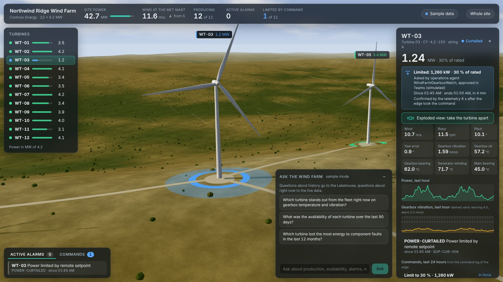
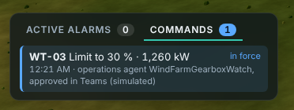

# Deployment guide, Phase 5c: the edge keeps a record, and the twin shows who asked

Phase 5a sent a command from Fabric to a turbine. Phase 5b let the operations agent propose one and a person approve it. What was missing is the way back: a record of what the plant was told, and a look at whether it followed. Until now the only trace of a command was the telemetry it changed, and the telemetry does not say who asked.

Phase 5c adds that record at the place where a command becomes true, the edge. The simulator now reports every operating command it is given: what, for which turbine, from whom, from the cloud or at the edge, and whether it took it. The report travels with the telemetry into the KQL database. A function there puts each command next to what the telemetry showed afterwards. The command center reads it after every send, and the twin shows who limited a turbine, since when and until when.

**Status of this guide.** Written on 25 November 2026 and run the same night, between 00:45 and 01:35. **Steps 1 to 5 work on the tenant**, seen in two pictures of the twin with its connection check: both commands that had been sent are in the log with who asked, the function calls one `in force` and the other `ended`, the service principal may run it, and the twin shows the card, the tab and the figure. One obstacle on the way, at step 3: the script of Phase 1 stood at the Azure CLI's search for a newer extension; it no longer makes that search. Step 6, the story with the agent, has not run. Not seen: the outputs of the single steps (the answer of Block 1, the status line with 1.2.0, the rows of Block 3, the command center's lines). [What was and was not tested](#what-was-and-was-not-tested) has what was tested here before the run, what the run showed, and what is still open.

## Contents

- [What you get](#what-you-get)
- [Before you start](#before-you-start)
- [Step 1: The table and the function](#step-1-the-table-and-the-function)
- [Step 2: The simulator, version 1.2.0](#step-2-the-simulator-version-120)
- [Step 3: Let the data flow forward the log](#step-3-let-the-data-flow-forward-the-log)
- [Step 4: The command center reads the log](#step-4-the-command-center-reads-the-log)
- [Step 5: The twin shows it](#step-5-the-twin-shows-it)
- [Step 6: Show it](#step-6-show-it)
- [If something fails](#if-something-fails)
- [How it works](#how-it-works)
- [What was and was not tested](#what-was-and-was-not-tested)
- [What this phase leaves open](#what-this-phase-leaves-open)
- [Go back](#go-back)

## What you get

| Item | Where | What it is |
|---|---|---|
| Simulator **1.2.0** | Edge | For every operating command (`curtail`, `release`, `stop`, `start`, `reset`) it publishes one message of type `command` per turbine the command acted on, on the topic `contoso/windfarm/{site}/{turbine}/command`. A refused command is reported once, with the reason. Commands from Fabric and commands given at the edge with `simctl` are both reported, and told apart |
| Data flow **windfarm-to-fabric**, one more topic | Azure IoT Operations | Forwards `…/command` with the six kinds of message it already forwards |
| Table **EdgeCommands** | KQL database `WindFarmEH` | One row for each of those messages: when the edge handled the command, the turbine, who asked, the limit in kW, when it ends, and `Ok` or the reason for the refusal. Filled by an update policy |
| Function **CommandLog(lookback)** | KQL database `WindFarmEH` | Each command with what the telemetry showed afterwards: `ConfirmedAt`, `EndedAt`, a `Status` in words (`in force`, `ended`, `confirmed`, `refused`, or taken by the edge and not seen in the telemetry), and two times in seconds: from Fabric to the edge, and from the edge back as a reading |
| Notebook **13_command_center**, new version | Fabric workspace | After a send it first reports the edge's own word (taken, or refused and why), then the telemetry. `history()` prints the command log. It works as before on a database without the log |
| The twin, new version | Fabric app `WindFarmTwin` | The panel of a turbine says who limited it, since when, until when and whether the telemetry confirmed it. A tab beside the alarms lists the commands of the last 24 hours. The top bar counts the turbines a command holds down. The twin sends nothing |
| `tools/kql-semantic-check.js` | Repository | Checks every KQL file against the tables of the database, offline: unknown columns, wrong types. It found two mistakes in this phase's function before you could |

```text
 Fabric                                                Edge
+----------------------+  eventstream         +------------------------------------+
| notebook 12 (agent)  |  WindFarmCommands    | data flow --> control topic        |
| notebook 13 (by hand)|--------------------->|                  |                 |
+----------------------+                      |                  v                 |
                                              |              simulator             |
+----------------------+                      |    applies the command, and logs   |
| KQL database         |  eventstream         |    it on the topic .../command     |
|  RawEvents           |<---------------------| data flow <-- telemetry, alarms,   |
|   |-> TurbineTelemetry                      |               command log          |
|   |-> EdgeCommands   |                      +------------------------------------+
|  CommandLog()        |
+----------------------+
    |              |
 the twin     the command center
```

## Before you start

- **Phases 5a and 5b are deployed**, and the repository copy on the workstation has the files of this delivery.
- **The edge VM is running** (`bash infra/vm.sh status`). It stops every day at 08:00 UTC, which is 02:00 in Houston.
- **Nothing is running that you want to keep.** Step 2 restarts the simulator. A restart ends what was set while it ran: a wind you set, a fault you injected, a limit on a turbine. Steps 2 and 3 each interrupt the telemetry. On 25 November the hour that held both was short of five to six minutes of readings, by a calculation from one line of the connection check.
- You are signed in on the workstation with `az login`, as for the earlier phases.
- Notebook 12, the agent and its table are not touched by this phase.

Time: about 40 minutes for steps 1 to 5, a third of it waiting for builds.

## Step 1: The table and the function

**[Fabric]** Open a query window on the KQL database `WindFarmEH` and open `fabric/kql/07-command-log.kql` from the repository copy next to it.

1. Paste **Block 1**, from `.execute database script <|` to the single `}` that closes the function `CommandLog`, and run it.
2. Paste **Block 2** and run it.

**Check.** Block 1 answers with seven rows, each with `Result` = `Completed`: the table, its description, the descriptions of its columns, the retention, the function of the update policy, the update policy, and the function `CommandLog`. Block 2 runs and returns no rows: nothing has been logged yet.

**Send me** the answer of Block 1 if any row is not `Completed`. The file passed both offline checks and has not run in an Eventhouse.

## Step 2: The simulator, version 1.2.0

**[Workstation]** Name the new image in your settings. The line prints what the file then says.

```bash
sed -i 's/^SIM_IMAGE=.*/SIM_IMAGE="windfarm-simulator:1.2.0"/' config/demo.env && grep SIM_IMAGE config/demo.env
```

Copy the repository to the VM, then build the simulator there and start it. It is one line because the second half is the one that changes anything: the copy alone leaves the old simulator running. It takes a few minutes and ends with some lines of the simulator's log.

```bash
bash infra/vm.sh push && bash infra/vm.sh ssh bash ./edge/scripts/05-deploy-simulator.sh
```

**Check.** The first line of the status names the version:

```bash
bash infra/vm.sh ssh bash ./edge/scripts/simctl.sh status
```

```text
Site northwind-ridge  simulator 1.2.0  seed …  uptime … s
```

The uptime is a minute or two. `simulator 1.1.0` with an uptime of hours means the simulator was not rebuilt: run the line above again.

**See the log on the edge.** In a second terminal, wait for one message on the new topic:

```bash
bash infra/vm.sh ssh bash ./edge/scripts/mqtt-peek.sh --count 1 'contoso/windfarm/+/+/command'
```

In the first terminal, limit a turbine for two minutes at the edge:

```bash
bash infra/vm.sh ssh bash ./edge/scripts/simctl.sh curtail WT-07 --percent 50 --duration 2m
```

The second terminal prints one message and ends. It is the edge's record of what you just did:

```text
contoso/windfarm/northwind-ridge/WT-07/command {"messageType":"command",…,"assetId":"WT-07",…,"data":{"requestId":"…","command":"curtail","source":"edge","requestedBy":"","issuedAt":null,"ok":true,"error":null,"percent":50.0,"limitKw":2100.0,"durationSeconds":120,"endsAt":"…","reason":null,"turbinesInCommand":1}}
```

`"source": "edge"` because the command came from `simctl` and not from Fabric. If the second terminal prints nothing, the simulator is not 1.2.0: look at the status again.

## Step 3: Let the data flow forward the log

The data flow of Phase 1 forwards six kinds of message by name. The command log is a seventh.

**[Workstation]** Run the script of Phase 1 again. It writes the endpoint and the data flow anew, with the seven topics.

```bash
bash infra/06-connect-edge-to-fabric.sh
```

Because it replaces a data flow that is running, it first compares the eventstream in `config/demo.env` with the one the data flow sends to, and stops when they differ. On your settings they are the same (compared by hand on 25 November: `esehdm7tokeyfmmg5r4qpk_eh` on both sides).

**Check.** It begins with the comparison and ends with the data flow and its topics:

```text
==> The data flow windfarm-to-fabric exists
    It sends to:       esehdm7tokeyfmmg5r4qpk_eh at ….servicebus.windows.net:9093
    The settings name: esehdm7tokeyfmmg5r4qpk_eh at ….servicebus.windows.net:9093
    The same eventstream. The endpoint and the data flow are written anew; the telemetry may pause for some seconds.
…
==> Done
Name                Mode     State
------------------  -------  ---------
windfarm-to-fabric  Enabled  Succeeded
    It forwards 7 topics: telemetry weather alarm state asset heartbeat command
```

Then limit a turbine at the edge once more, so that there is something to forward:

```bash
bash infra/vm.sh ssh bash ./edge/scripts/simctl.sh curtail WT-07 --percent 50 --duration 2m
```

**[Fabric]** One minute later, run **Block 2** of the KQL file again, and then **Block 3**.

**Check.** Block 2 has one row: `WT-07`, `curtail`, `Ok` = `true`, `Percent` 50, `LimitKw` 2100, `Source` = `edge`, `RequestedBy` and `IssuedAt` empty. Block 3 has the same command with `Status` = `in force`, a `ConfirmedAt` a few seconds after `Timestamp`, and `EdgeToTelemetrySeconds` between 0 and 5. Two minutes after the command, Block 3 says `ended`, with an `EndedAt` within a few seconds of `EndsAt`.

The command you sent in step 2 is not in the table. It was logged on the edge before the data flow forwarded the topic, and the broker does not keep messages nobody subscribed to.

**Send me** the rows of Block 3. This is the first time the function runs anywhere.

## Step 4: The command center reads the log

**[Fabric]** Replace the notebook in the workspace:

1. On **13_command_center**, select **…**, **Delete**. Nothing points to this notebook, so nothing else has to be set again.
2. **Import**, **Notebook**, **From this computer**, and choose `fabric/notebooks/13_command_center.ipynb` from the repository copy.
3. Open it and run the first two code cells. The second ends with the state of the turbines.
4. Run the cell `history()`.

**Check.** `history()` prints the commands of the last hour, newest first. The one of step 3 is there, asked `at the edge`:

```text
At (UTC)  Turbine  Command  Status                                        Limit kW Ends      To edge s To reading s  Asked by
-----------------------------------------------------------------------------------------------------------------------------
…         WT-07    curtail  ended                                             2100 …                 -            …  at the edge
```

Then send a command from Fabric. Run the cell:

```python
send("curtail", "WT-07", percent=30, duration="10m")
```

**Check.** Four lines after the command itself. The third is new: it is the edge speaking, before the telemetry does.

```text
Sent: curtail for WT-07, request …, at 2026-11-25T…Z UTC.
Waiting for the telemetry to show it: limit of 1260 kW in force on WT-07 (up to 150 s) ...
WT-07: the edge took the command 3 s after it was written (at …Z), in the log 25 s after the send.
WT-07: limit of 1260 kW in force, seen 30 s after the send (state CURTAILED, setpoint 1260 kW, power … kW, reading of …Z).
```

The seconds are examples. "After it was written" is the way from Fabric to the edge. "In the log" and "seen" are how long it took until the row and the reading were in the database, which includes the 20 seconds the Eventhouse collects before it stores. The two lines can come in either order.

Run `history()` again: the command is `in force`, asked by you, with the two times. Then run the cell `send("release", "WT-07")` and `history()` once more: the limit is `ended`, the release `confirmed`.

**Send me** the output of the `send` cell and of the last `history()`. This notebook has not been reported as run in Fabric at all, so its first two cells are news too.

## Step 5: The twin shows it

**[Workstation]** Copy the new files into the app and check them:

```bash
bash app/create-app.sh
```

Deploy:

```bash
cd app/windfarm-twin && export RAYFIN_ENCRYPTION_FALLBACK_ENABLED=true && npx rayfin up
```

If it says you are not signed in, run `npx rayfin login` in the same terminal and then `npx rayfin up` again. Afterwards go back to the repository folder: `cd ../..`

**[Fabric]** Open **WindFarmTwin** and select the badge at the top right for the connection check.

**Check.** The three `build` lines read `455aa9777780`, and the Eventhouse route has a new last line:

```text
PASS  Eventhouse route: command log: … lines in the last 24h, … limits in force
```

If that line says `SKIP … not there`, step 1 did not run in this database; the line quotes what the database said.

The last line of the check, `Lakehouse route: query`, may say `FAIL … found no telemetry in the last 60 minutes` while everything above it passes. That happened on 25 November. The twin reads the Eventhouse, so nobody had asked the Lakehouse's SQL endpoint for a long time, and by Microsoft's page on that endpoint it follows new data only while it is in use ([SQL analytics endpoint performance considerations](https://learn.microsoft.com/en-us/fabric/data-engineering/sql-analytics-endpoint-performance)). Select **Check again** a few minutes later: on 25 November it passed three and a half minutes after it had failed, with the newest row 2 minutes old. From this build on the line says so itself.

Then look at the page while WT-07 is limited (send the curtailment of step 4 again if it has ended):

- The top bar has a new figure, **Limited by command**: `1 of 12`.
- Select WT-07. Under its power, a blue card says what holds it down:

  ```text
  Limited: 1,260 kW · 30 % of rated
  Asked by MOD Administrator
  Since 10:21 PM · ends 10:31 PM, in 8 min
  Confirmed by the telemetry 4 s after the edge took the command
  ```

  In a weak wind a fifth line says that the wind gives less than the limit, so the power is not held down. Further down, the controller's own note `POWER-CURTAILED Power limited by remote setpoint` is listed, and **Commands, last 24 hours** lists what this turbine was told.
- **Active alarms** in the top bar stays at what it was. The controller's note about the limit is a note, not an alarm: it is listed in grey and not counted. (In the first build of this phase, `b0a8ce151d05`, it was counted, and a limit sent by hand showed a red `1`.)
- At the lower left, the panel of the alarms has a second tab, **Commands**, with the commands of the last 24 hours for the whole site. A command to all twelve turbines is one line.

The times on the page are those of your browser's clock; the KQL database shows UTC. A new command reaches the page up to a quarter of a minute after the turbine's own values do: the app reads the log once in 15 seconds.





Both pictures are from the preview on sample data (`app/preview/windfarm-twin-preview.html`), where a button simulates an approved limit. In the deployed twin there is no such button.

**Send me** the text of the connection check (**Copy the result**) and a picture of the page with the card.

## Step 6: Show it

The story is the one of Phase 5b, step 6, with an ending. Set the wind and start the fault as there:

```bash
bash infra/vm.sh ssh bash ./edge/scripts/simctl.sh wind --mean 13 --duration 90m
```

Ten minutes later:

```bash
bash infra/vm.sh ssh bash ./edge/scripts/inject-anomaly.sh WT-03 gearbox_degradation 0.2 60m
```

Have the twin open on WT-03, and the command center with `history()` ready.

| When | What happens | Where it shows now |
|---|---|---|
| Minutes 3 to 9 after the fault | Vibration crosses 4 mm/s, the controller warns on oil temperature, the agent writes to Teams | As in Phase 5b: amber and red in the twin, the message in Teams |
| On approval | The agent starts notebook 12 as a job. On 24 November the job needed 105 and 153 seconds before the notebook started | The notebook's **Recent runs** |
| Seconds after the notebook's send | The edge takes the command and logs it | Twin, within half a minute: the card on WT-03 begins **Limit on its way**, asked by `operations agent WindFarmGearboxWatch, approved in Teams` |
| One round of telemetry later | WT-03 reports the limit | Twin: the card says **Limited: 1,260 kW**, with the confirmation; the ring is blue; **Limited by command** is `1 of 12`. `history()`: `in force` |
| 4 to 9 minutes later | The oil temperature falls and the controller's warning clears | Twin: the alarm leaves the list, the card stays |
| 60 minutes after the approval | The limit ends by itself | Twin: the card is gone, the **Commands** tab says `ended`. `history("2h")`: `ended`, with the time |

**What to say with it.** The agent proposed, a person approved, and the plant's own record says what it was told and by whom. The confirmation does not come from the notebook that sent the command and not from the agent: it comes from the edge and from the turbine's readings. `Asked by` is the text the agent passed. Who pressed **Yes** in Teams is not in it; see [What this phase leaves open](#what-this-phase-leaves-open).

**Send me:** `history("2h")` after the run, or the rows of Block 3; a picture of the twin with the card of the agent's limit; and, if you have them, the four clock times asked for in Phase 5b (fault started, message arrived, approved, ring blue).

## If something fails

| Symptom | Where it stopped | Do |
|---|---|---|
| Step 1: a row of Block 1 is not `Completed` | The KQL database | Send me the row. The commands before it have run; running the block again after a correction is safe |
| Step 2: `05-deploy-simulator.sh` stops in `docker build` | The build on the VM | Send me the last 30 lines. The old simulator keeps running until the new one starts |
| Step 2: the status still says `simulator 1.1.0` | The copy on the VM is the old one | `bash infra/vm.sh push` again, then the deploy script |
| Step 2: `mqtt-peek` prints nothing after the `simctl curtail` | The simulator did not log | The status line: is it 1.2.0? Then `bash infra/vm.sh ssh kubectl logs deployment/windfarm-simulator -n windfarm --tail=30` and send it |
| Step 3: the script prints `WARNING: EVENTSTREAM_TOPIC normally starts with 'es_'` and then stands at ` - Searching ..` | A copy of the script from before 25 November, 01:30. The warning was wrong for this tenant, and the Azure CLI's search for a newer extension has no time limit | Ctrl+C: nothing was changed yet. Take `infra/06-connect-edge-to-fabric.sh` and `config/load-env.sh` from the current archive and run it again |
| Step 3: `The settings in … name another eventstream than the one the data flow sends to` | The settings file | Nothing was changed. The two lines above the message show both. `bash infra/rebuild-env.sh --force` reads the settings from what is deployed |
| Step 3: the script stops at the endpoint or the data flow | Azure IoT Operations | Send me its last lines. The data flow that was there stays as it was until the new one is accepted |
| Step 3: after the script, the twin and the queries show no new telemetry for more than two minutes | The data flow did not come back | `az iot ops dataflow show` is what the script prints at its end: `State` must be `Succeeded`. Then [troubleshooting.md](troubleshooting.md), section "No events in the eventstream" |
| Step 3: Block 2 stays empty, and `RawEvents \| where timestamp > ago(10m) \| summarize count() by messageType` has no `command` | The topic is not forwarded | The script's output: did it end with `Succeeded`? `cat edge/dataflows/rendered/windfarm-to-fabric.json` must list seven topics |
| Step 3: `RawEvents` has `command`, `EdgeCommands` is empty | The update policy | `.show table EdgeCommands policy update` and send me the result. An update policy acts on what arrives after it was set: send one more command |
| Step 3: Block 3 answers with an error | The function | Send me the error. Block 2 still works. The twin and `history()` read the function, so until it is corrected they show no commands, and the twin's connection check says why |
| Step 3: a command stays `taken by the edge, not yet seen in telemetry` and then turns `never seen` | The telemetry did not show it within five minutes | Is the turbine reporting? `status("WT-07")` in the command center. A turbine with a communication loss is one such case, and the status is then true |
| Step 4: `The KQL database answered 400` on the first `send` | The query for the log | Send me the message. The notebook is built to run on a database without the log; that this works is one of the unproven things |
| Step 4: `This database has no command log yet` | Step 1 ran in another database, or not at all | Step 1 |
| Step 4: `The edge's log has no entry for this command`, and the telemetry shows the command | The log's way back, not the command | Steps 2 and 3: the simulator's version, and the seven topics |
| Step 4: `The edge refused the command: …` | The edge | The reason is the edge's own. A command the notebook lets out should not be refused; send me the line |
| Step 5: `FAIL Lakehouse route: query: … found no telemetry in the last 60 minutes`, and the Eventhouse route passes | The Lakehouse's SQL endpoint had not been asked for a while and was behind | **Check again** after two or three minutes. If it still fails: `.show table TurbineTelemetry operations mirroring-status` in the KQL database says whether the Eventhouse still writes the copy; send me the row |
| Step 5: the connection check has no line `command log` | The functions are an older build | The three `build` lines differ from the one in step 5. `npx rayfin up` again; wait two minutes between two deployments of functions |
| Step 5: `SKIP Eventhouse route: command log` | The database refused the query | The line quotes the database. Step 1, or the service principal has no right to run the function: send me the line |
| Step 5: the page shows the limit as `A limit is set. Who asked for it is in the command log, which is read on the Eventhouse route only.` | The live values come from the Lakehouse copy | The badge says `Lakehouse copy`. The connection check says why the Eventhouse route is not used |
| Step 5: the card says `the command log has no line for it` | The limit was set before step 3, or more than 24 hours ago | Send a new one |

## How it works

**Why the edge writes the record.** The notebook knows what it sent. It does not know what arrived, and a job started by the agent has nobody reading its output. The edge is where a command is taken or refused, and it is also where commands come from that Fabric never saw: someone at the plant with the local tool. One record at that place covers both, and it is what a turbine controller keeps anyway: a log of the setpoints and stops it was given.

**Why it travels with the telemetry.** The log is one more kind of message on the path of Phase 1: broker, data flow, eventstream, `RawEvents`, update policy. No new item in Fabric, no second connection, and the same clock as the readings it is compared with. The price: when that path is down, the log is down with it. A command that was applied then shows in the telemetry once the path is back, and has no line.

**Two confirmations, and what each means.** `Ok` in `EdgeCommands` is the edge's word: it took the command, or it refused it and says why. `ConfirmedAt` in `CommandLog` is the plant's: the first reading of that turbine, within five minutes of the command, that shows it.

| Command | A reading shows it when |
|---|---|
| `curtail` | its power setpoint is at or below the limit |
| `release` | its state is not `CURTAILED` |
| `stop` | its state is `STOPPED` or `MAINTENANCE` |
| `start` | its state is neither of those |
| `reset` | its state is not `FAULT` |

A curtailment is confirmed by the setpoint and not by the power, because in a weak wind the turbine gives less than the limit anyway and its power then shows nothing. For the same reason a `release` or a `reset` of a turbine that was not limited or tripped is confirmed at once: the reading already looks as asked. The edge's line is what says the command arrived.

**One command, one line.** The path from the broker to the database delivers a message at least once, so a report can arrive twice. `EdgeCommands` then has two equal rows; `CommandLog` keeps one for each turbine, request, command and time.

**In force, ended.** A limit is `in force` from its confirmation until one of three things: its time is over, the setpoint in the telemetry rises above it, or the edge takes a later limit or a release for the same turbine. So at most one limit per turbine is in force, also when a second one is tighter and the telemetry alone could not tell them apart.

**The two times.** `FabricToEdgeSeconds` is the edge's time of the command less the time the sender wrote into it. Two clocks are in that number, and the sender's has whole seconds, so read it to a second or two. For a command of the agent it starts when notebook 12 builds the command, not when the person approved: the two to three minutes a job waits for its session are before it. `EdgeToTelemetrySeconds` is on one clock, the edge's: from the command to the first reading that shows it. It cannot be shorter than the wait for the next round of telemetry, up to 5 seconds.

**What the command center does with it.** After a send it asks the database for the edge's line of that request, by its identifier, and for the newest readings, every 5 seconds for up to 150. A refusal ends the wait at once with the edge's reason. A turbine that was already as the command asks used to be the case the notebook could say nothing about; the edge's line now settles it. The query is written so that it also runs on a database without the table (`union isfuzzy=true`), and the notebook then follows the telemetry as before.

**What the twin does with it.** The function of the app that reads the live values asks for `CommandLog(24h)` as a fourth query, at most once in 15 seconds. When the database refuses that query, the turbines are shown as before, the page shows no commands, the connection check says why, and the query is not tried again for five minutes. The card of a turbine compares the setpoint in the telemetry with the newest limit the log calls in force:

| The card says | When |
|---|---|
| **Limited**, asked by, since, ends, confirmed | The setpoint is the limit of a command in the log |
| **Limit on its way** | The edge has the command, the telemetry does not show it yet |
| By the turbine controller itself | The setpoint is lower than any command asked for: a derate on an alarm. A command's limit that also holds is named in a second line |
| The command log has no line for it | A limit is set that the log does not explain: set before the log existed, or more than 24 hours ago |
| Who asked is not known here | The live values come from the Lakehouse copy, or the database has no command log |

**The twin sends nothing.** You chose that on 24 November. Everyone the app is shared with acts as its owner, so a button there would be a button for all of them. The preview on sample data has one, labelled as a simulation, so that the card can be looked at without Fabric.

**The Lakehouse route.** `EdgeCommands` is not copied to OneLake, so the twin on that route shows a limit without its author, and the data agent does not know the table. Both are a small step and are left for a decision: see below.

**A new check for the KQL.** The syntax check of the earlier phases reads grammar. This phase's function joins two tables and compares their columns, which grammar cannot check, so there is now a second tool that loads the tables from the repository's own `.create-merge table` commands and analyses every stored function and every query block against them. It runs over all KQL files of the repository, 58 functions and blocks. It found nothing in the files of the earlier phases, and in this phase's function two variable names that are keywords of the language.

## What was and was not tested

**Run, without Fabric and Azure**

| What | How | Result |
|---|---|---|
| The simulator's report | 21 tests in `test_command_log.py`, with the next two rows: one message for the turbine a command acted on, twelve under one request for a command to all, each of the five commands with what it carried, a refusal once with its reason and under the right asset, commands at the edge marked as such, simulator-only commands (a fault, the wind) not reported, a turbine that is offline still reported at once, the turbine's own numbering unbroken | Pass. Seven planted faults in the simulator's code each failed at least one test |
| The path's files | The data flow's seven topics are exactly the seven kinds of message the simulator sends in a run with a fault and a command; neither the control topic nor its answers are among them. The table's columns, their types, their descriptions and the update policy name exactly the fields of the message | Pass |
| The rules of `CommandLog` | A Python copy of the function's rules, run on the simulator's messages at 13 and at 7 m/s: taken and not yet seen; in force; ended by its time, by a release, by a later limit whether tighter or looser; stop, start and reset; a refusal; a turbine that does not report, and one that reports again in time; a message that arrives twice. A test compares the constants and the words of the two texts, and another the guide with the files: the build of the app, the version, the seven commands of Block 1 | Pass. The copy is mine: that the KQL computes the same is shown by step 3 |
| The KQL | The syntax check, and the new check against the tables: columns, types, arguments | No diagnostics in 58 functions and blocks. Not run in an Eventhouse |
| The command center | 31 tests. Its cells run against stand-ins joined to a simulator that keeps the log: every sent command is confirmed first by the edge, then by the telemetry; a command changed on the way is refused with the edge's reason and nothing is waited out; a lost command is told apart from a lost log; `history()`; a database without the log. Its queries pass both KQL checks | Pass. Seven planted faults each failed a test, one only after a test was strengthened |
| The twin's functions | 48 tests of the functions, 7 of them new, one of those after the first run (the sentence of the Lakehouse line when the SQL endpoint is behind): the mapping from the function's columns, which a test reads from the KQL file; a database without the log leaves the turbines shown and is not asked again for five minutes; a failure that may pass is asked again; one read in 15 seconds; the Lakehouse route; the connection check | Pass |
| The twin's page | 11 new tests: what holds a turbine down in each of the five cases, the words of the card, the commands as groups, and the sample data's limit from taken to ended. After the first run, one more: a note of the controller is listed and not counted. The app's 123 tests pass; the TypeScript compiler passes on the files alone and on a copy of Microsoft's template with the files laid over it | Pass. Of ten faults planted in the twin's code, nine failed a test at once and one after a test was added. An eleventh showed two lines that did nothing; they are gone |
| The pictures | The preview in a headless browser, eight pictures; the script fails when the card, the count in the top bar or the tab do not say what they should, and since the first run also when the controller's note is counted as an alarm or marks the turbine red | Pass. Software rendering, sample data |

**Read in Microsoft's documentation on 25 November 2026, not run**

- `az iot ops dataflow endpoint create fabric-realtime` creates or replaces the endpoint, and `az iot ops dataflow apply` creates or replaces the data flow. Step 3 relies on both for running the script of Phase 1 a second time.

**Seen in the first run, 25 November 2026, 00:45 to 01:35**

| Step | What was seen |
|---|---|
| 2 | The `sed` line and the copy to the VM. Then `simulator 1.1.0` with an uptime of 5.7 hours: the build had been left out, which the guide had given as a block of its own. It is one line now |
| 3 | The script of Phase 1 printed a warning about the topic's name and stood at ` - Searching ..`. The warning was wrong and the search has no time limit; both are gone. By hand: the topic in the settings and the topic of the running data flow are the same, `esehdm7tokeyfmmg5r4qpk_eh` |
| 1 to 5, in the twin at 01:31 | Build `b0a8ce151d05` on the page and on both sets of functions. `PASS Eventhouse route: command log: 2 lines in the last 24h, 1 limit in force`. In the **Commands** tab: `WT-07 Limit to 50 % · 2,100 kW`, `ended`, 01:18, `someone at the edge, with the simulator tool`; and `WT-07 Limit to 30 % · 1,260 kW`, `in force`, 01:25, `MOD Administrator`. The card on WT-07: `Limited: 1,260 kW · 30 % of rated`, `Asked by MOD Administrator`, `Since 01:25 AM · ends 01:35 AM, in 5 min`, `Confirmed by the telemetry 2 s after the edge took the command`. The turbine at 1.27 MW, 30 % of rated, in a wind of 9.8 m/s. **Limited by command** `1 of 12` |
| The same check | `delay from turbine to database: median 38 s, 95 % of the rows within 38 s, highest 39 s, over the 2064 rows of the last 15 minutes`: the first measurement of that delay over more than one reading, and no row missing in those 15 minutes |
| The same check | `FAIL Lakehouse route: query: the query ran and found no telemetry in the last 60 minutes`. At 01:34, after **Check again**: `PASS … 7548 rows from 12 turbines in the last 60 minutes; newest 2 min old`. Twelve turbines every 5 seconds for the 58 minutes up to the newest row are 8,352 rows, so the hour that holds steps 2 and 3 is short of about 800 rows: five to six minutes of telemetry, the age of the newest row being a rounded figure |
| The page | **Active alarms** `1`, in red, and a red mark on WT-07 in the list: the controller's note `POWER-CURTAILED`. A note is not an alarm; the page no longer counts it |

What follows from the picture and was not seen by itself: Block 1 ran; the simulator is 1.2.0 (a command given at the edge is in the log as such); the script of step 3 ran through after the correction (the topic is forwarded); a notebook sent the command of 01:25 from Fabric.

**Unproven: what your run decides** (written before the run; what the run showed is added to each)

1. **The second run of the Phase 1 script.** That Azure IoT Operations takes the endpoint and the data flow anew, and how long the telemetry pauses. Step 3. *25 November: it does, by its result; the first try stood at the Azure CLI's search for a newer extension, which the script no longer makes. The pause is not separated from that of step 2: about five and a half minutes for both.*
2. **The command message through the eventstream.** It has the envelope of the other six kinds, so `RawEvents` should take it as it takes them. Step 3. *25 November: it arrives.*
3. **The KQL, anywhere.** That Block 1 runs, that the update policy fills `EdgeCommands`, and that `CommandLog` says what its Python copy says. Step 3. *25 November: yes for the two cases the run had, a limit in force with its confirmation and a limit that ended. Whether that one ended by its time or by the limit that came after it, the word `ended` does not say. Not met yet: a refusal, a release, a turbine that does not report.*
4. **The cost of `CommandLog(24h)`.** It joins the day's commands with the telemetry of the turbines they named. The twin asks once in 15 seconds. With a handful of commands it should be small; I have no measurement.
5. **`union isfuzzy=true`.** That the command center's query runs on a database without the table. Microsoft documents it for missing tables; your database has the table after step 1, so this is only met if step 1 is skipped.
6. **The command center in Fabric.** Its reading of the KQL database with the notebook's token, which no run has shown yet, and how the database writes a `bool`. Step 4. *25 November: a command was sent from Fabric as MOD Administrator; by which notebook, and what it printed, was not sent.*
7. **The service principal and the function.** That the principal of the twin, a viewer of the database, may run `CommandLog`. Step 5. *25 November: it may.*
8. **The times.** From Fabric to the edge, from the edge to a reading, and how long after an approval the card appears. Steps 4 and 6. *25 November: from the edge to a reading 2 s, once; from a reading to the database 38 s. From Fabric to the edge: in the command center's output, not sent.*

## What this phase leaves open

Said plainly, because the roadmap promised more for 5c than this delivers.

- **The agent does not confirm, and does not come back.** It sends one message, the proposal. It does not write a second one when the limit is in force, and when the limit ends after its hour with the fault still there, the turbine returns to full power with its vibration already above 4 mm/s and the rule, which waits for a crossing, may stay silent. The data for both is now there (`CommandLog`); the rule is not built.
- **Who approved is not recorded.** The command carries the text the agent passes, `operations agent WindFarmGearboxWatch, approved in Teams`. Fabric starts the notebook with the rights of the agent's creator and does not hand it the name of the person who pressed **Yes**. That name is in Teams and in the agent's activity.
- **No work order.** The roadmap spoke of a work order row for the event. The record is the command log; nothing writes to the maintenance tables.
- **A command that never reaches the edge has no line anywhere.** The log starts at the edge. What Fabric sent is in the notebook's output and, for the agent, in the job's run. The command center notices such a command by the missing line.
- **The data agent does not know the log**, and the Lakehouse has no copy of it. One command in `fabric/kql/03-onelake-availability.kql` and one source in the data agent's notebook would add both; then "who limited WT-03 yesterday?" becomes a question for the chat.
- **No controls in the twin**, by your choice.
- **The job still waits two to three minutes for its session.** Notebook 12 runs on the PySpark kernel. Microsoft says a Python notebook starts in about five seconds. To try it: open **12_send_edge_command**, on the **Home** tab change the language from **PySpark (Python)** to **Python**, let it save, and run `bash infra/09-remediation-agent.sh --rehearse WT-07`. The notebook keeps its id, so the agent's action still points to it. The rehearsal prints the seconds; on 24 November they were 137 and 196 on PySpark. Not tried.
- **The script of Phase 5b, step 4**, is still refused by Fabric. The two saved definition files would show why: `fabric/operations-agent/saved/WindFarmGearboxWatch-20261125T040834Z.json` and `…-20261125T044537Z.json`.

## Go back

Each part can be left in place without harm; to remove them:

- **The twin**: nothing to undo. Without the function `CommandLog` it shows no commands and says so in its connection check.
- **The command center**: nothing to undo. Without the table it follows the telemetry only.
- **The table and the function**: the three commented lines at the end of `fabric/kql/07-command-log.kql`, without their `//`.
- **The topic**: remove the line `"contoso/windfarm/+/+/command"` from `edge/dataflows/windfarm-to-fabric.template.json`, with the comma before it, and run `bash infra/06-connect-edge-to-fabric.sh`.
- **The simulator**: version 1.2.0 differs from 1.1.0 only by the report. Left running without the topic being forwarded, it changes nothing in Fabric.
